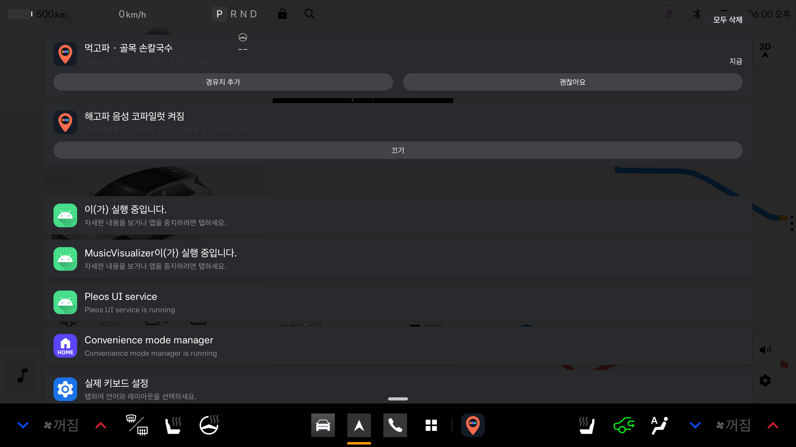
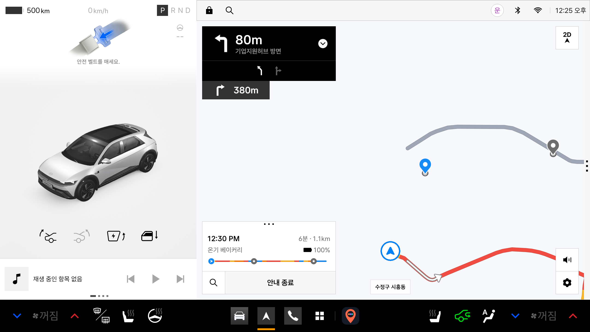
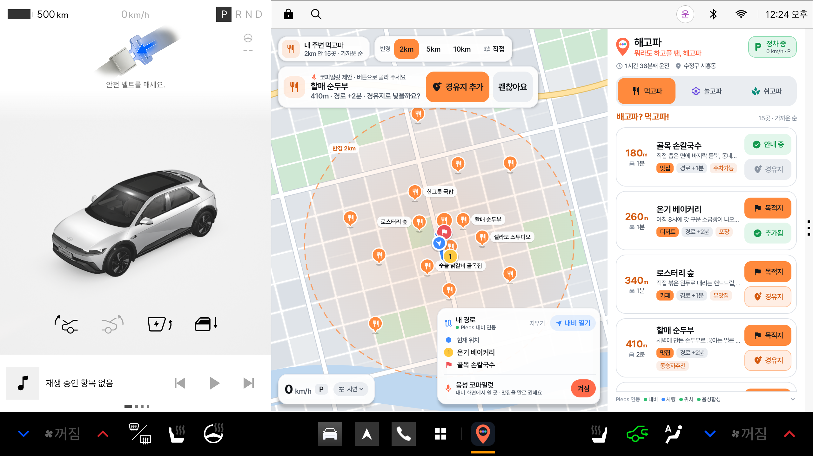
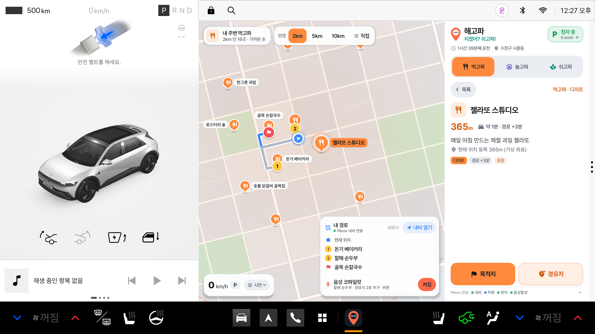
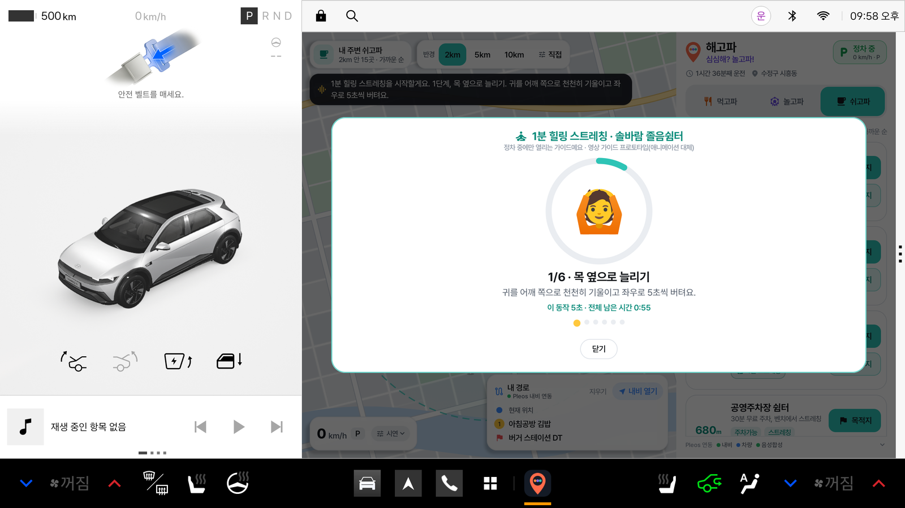
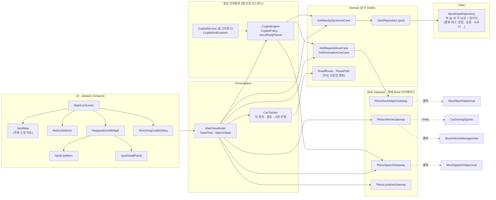

<div align="center">

# 🍽️🎡🌿 해고파 (HAEGOPA)

**배고파? 먹고파! 심심해? 놀고파! 지쳤어? 쉬고파!<br/>차 안에서 뭐라도 하고플 땐? 👉 해고파**

맛집 · 카페(먹고파) / 공원 · 놀이공원 · 명소(놀고파) / 산책로 · 사우나 · 마사지(쉬고파)<br/>
차를 따라 움직이는 반경(2·5·10km) 큐레이션 × 순정 내비 원터치 [목적지] · [경유지] × **내비를 띄운 채 말로 권하는 음성 코파일럿** × 주행 중 동승자 모드<br/>
Pleos Connect를 위한 **차량 네이티브** 인포테인먼트 앱 · **Pleos Connect Emulator 실기 검증 완료**

`Android Automotive OS` · `Pleos Connect SDK` · `Kotlin` · `Jetpack Compose` · `MVVM Clean Architecture`

</div>

---

## 📦 바로 실행하기 (심사용 요약)

| 항목 | 내용 |
|---|---|
| **앱 이름** | 해고파 (HAEGOPA) · 패키지 `com.haegopa.app` |
| **한 줄 소개** | 차 위치 기준 반경(기본 2km) 안에서 먹을 곳(맛집 · 카페), 놀 곳(공원 · 백화점 · 놀이공원 · 명소), 쉴 곳(산책로 · 공원 · 목욕탕 · 사우나 · 마사지)을 가까운 순으로 추천하고, 카드의 **[목적지] · [경유지]** 한 번으로 Pleos 순정 내비 길안내까지 이어 주는 차량 전용 앱. 순정 내비를 띄워 둔 채 달려도 식사 시간 · 장거리 운전 때 **음성으로 먼저 권하고 "응" 한마디(또는 버튼)로 경유지에 넣어 줍니다.** |
| **APK 위치** | [`apk/TEAM_HAEGOPA_release.apk`](apk/) — release 빌드 (약 44MB) |
| **권장 테스트 환경** | Pleos Connect Emulator v2.1.0 (Automotive · API 34 · 2560×1440) — ✅ 실기 검증 완료 ([검증 현황](#검증-현황)) |
| **보조 테스트 환경** | 일반 Android AVD (API 28 이상, 폰·태블릿). Pleos SDK가 없으면 내장 Mock으로 자동 전환되어 모든 화면을 시연할 수 있음 |
| **필요한 설정** | 없음. 처음 실행하면 차속 · 차 위치(Pleos FusedLocation) · 마이크(코파일럿에 "응 / 아니" 대답) · 알림 권한을 묻습니다(`adb install -g` 로 미리 허용 가능). 거부해도 앱은 동작합니다 — 마이크가 없으면 코파일럿에 버튼으로 대답합니다. (선택) Virtual Console 연결 `adb forward tcp:8088 tcp:8088` |

```bash
adb install -r apk/TEAM_HAEGOPA_release.apk
adb shell am start -n com.haegopa.app/.MainActivity
```

> 💡 차속 신호가 없는 환경에서도 지도 좌하단 **[시연]** 패널(정차 / 30 / 60 / 100 km/h · +30분)로 정차·주행 UI 전환을 바로 확인할 수 있습니다. **[코파일럿]** 을 누르면 순정 내비가 앞으로 나오고 6초 뒤 코파일럿이 지금 탭(먹고파 · 놀고파 · 쉬고파)으로 말을 겁니다.

## 📸 화면

> **Pleos Connect Emulator v2.1.0**(2560×1440)에서 캡처했습니다. 왼쪽은 Pleos 차량 패널이고, 오른쪽 메인 영역이 해고파입니다. Pleos에서는 앱이 순정 내비와 **같은 자리**에 열립니다. 그래서 해고파 화면에는 자체 "주변 스팟 지도"를 두고, 실제 길안내는 순정 내비에 맡깁니다.

| 🅿️ 정차: 차를 가운데 둔 반경 2km 원 · 먹고파 거리순 피드 · 내 경로(① ② 경유지 → 🚩 목적지) · 음성 코파일럿 켜짐 | 🚗 주행: 차는 화면 한자리에 그대로, 지도가 움직이고 반경 원 · 목록이 차를 따라옴 · 동승자용 큰 글씨 목록 |
|:---:|:---:|
|  |  |
| **🎙 순정 내비를 띄운 채: 코파일럿이 말로 묻고(TTS) 대답을 듣고(STT), 알림 센터에도 [경유지 추가] · [괜찮아요]** | **🎙 [경유지 추가] → 순정 내비가 바로 재탐색 (진행 바의 회색 점 2개 = 경유지 2곳)** |
|  |  |
| **🎙 점심 시간 자동 제안 중에 해고파로 돌아오면: 같은 질문이 지도 위 배너로** | **📍 핀이나 카드를 누르면: 지도가 그 위치로 확대 + 오른쪽에 상세 패널이 스윽** |
|  |  |
| **🧭 [목적지] → 안내 중이던 경로를 버리고 "골목 손칼국수"로 새로 길안내** | **🧭 [경유지] → 목적지는 그대로, "온기 베이커리"를 먼저 들르도록 재탐색** |
|  |  |
| **🌿 쉬고파 산책로: 1분 힐링 스트레칭 (정차 전용 · 단계별 음성)** | |
|  | |

> 첫 화면의 버튼 상태는 순정 내비의 실제 경로를 따릅니다. 골목 손칼국수는 목적지로 안내 중이라 **✓ 안내 중**, 온기 베이커리 · 할매 순두부는 경유지라 **✓ 추가됨**입니다. 할매 순두부는 순정 내비가 앞에 떠 있는 동안 코파일럿이 점심 시간에 먼저 권해서 들어간 경유지입니다(코파일럿 줄의 기록 참고). 순정 내비 화면의 진행 바에 찍힌 회색 점이 경유지입니다.

---

## 🏁 출품 공모전 개요

> 2026-11-06 기준으로 공식 사이트, 보도자료, Pleos 개발 문서를 확인해 정리했습니다. 세부 사항은 공식 공지가 우선합니다.

| 항목 | 내용 |
|---|---|
| 공모전 | **현대자동차그룹 차량용 앱 개발 공모전 — Code your App into Pleos App Market** |
| 주최 | 현대자동차그룹 |
| 목적 | 차량 데이터·기능·이동 상황을 활용해 운전자와 탑승자에게 새로운 경험을 주는 앱 발굴 |
| 예시 분야 | 모빌리티 & 라이프 편의 · 인카 엔터테인먼트 · 스마트 드라이빙 & 안전 · 패밀리 & 동승자 케어 (주제 제한 없음) |
| 참가 대상 | 대학(원)생 · 일반인 · 스타트업 / 개인 또는 팀(최대 5인) / 대학생 부문 · 일반 부문 |
| 접수 | 2026.10.21(수) ~ **11.15(일)** · 이메일 `appdevchallenge@hyundai-partners.com` · 접수양식(기획서) 필수 |
| 시상 | 총상금 5,100만원 · 10팀 (대상 1,000만원 · 최우수 600만원 · 우수 400만원 · 아이디어 특별상 150만원) + 숏폼 챌린지 50만원 별도 |
| 수상 혜택 | 2027년 2월 현대자동차그룹 행사 전시·시연, Pleos App Market 탑재 준비 지원 (입점이 보장되지는 않음) |
| 개발 환경 요건 | Android API 28 이상 · Gradle 8.0 이상 · Java 또는 Kotlin |
| 제공 SDK | Vehicle · NaviHelper · TextToSpeech · SpeechToText · FusedLocation (Pleos Connect SDK) |

### 일정

| 날짜 | 단계 |
|---|---|
| 2026.10.28 | 온라인 설명회 |
| 2026.11.15 | 접수 마감 |
| 2026.11.23 | 1차 서류심사 결과 발표 |
| 2026.12.03 ~ 12.04 | 2차 최종 PT 심사 (오프라인, **실제 동작하는 앱** 시연 필요) |
| 2026.12.18 | 최종 선정 결과 발표 |
| 2027.02 | 현대자동차그룹 행사 전시 · 시상식 (최종 순위 발표, 전시용 APK 필수) |

### 심사 기준과 해고파의 대응 (1차 서류심사, 배점 비공개)

| 평가 항목 | 공식 설명 (요약) | 해고파의 답 |
|---|---|---|
| **차량특화성** | 모바일보다 나은 차량만의 가치, 주행·정차 맥락과 차량 기능의 결합 | 차속·기어로 UI를 자동 전환(정차: 전체 탐색 / 주행: 동승자용 큰 글씨 목록 + 음성, AAOS UX 제한 기준 준수), 순정 내비에 목적지·경유지 원터치 전달, **순정 내비를 띄운 채 음성 코파일럿이 먼저 권하고 말로 승인**(운전자는 화면을 만지지 않음), 차를 따라 움직이는 반경, 2시간 연속 주행 시 쉴 곳 제안, Pleos 주야간 테마·화면 배율 대응 |
| **창의성** | 독창적 아이디어, 운전자·동승자의 분명한 Pain Point와 해결 방식 | "지금 차 주변 반경 안"이라는 거리 제한 큐레이션(2·5·10km·직접 설정)을 "먹을 곳 · 놀 곳 · 쉴 곳" 세 가지 기분으로 나눔, "가는 길에 들를지(경유지) / 아예 거기로 갈지(목적지)"를 카드에서 바로 고르는 흐름, 주행 중에는 동승자가 고르고 운전자는 음성으로 듣는 역할 분리 |
| **기술 활용성** | Pleos Playground SDK·API를 핵심 기능에 적절히 활용 | 제공 SDK 5종을 모두 핵심 기능에 씀 — NaviHelper(목적지 길안내 · 경유지 추가 · 주소 · 경로 상태 동기화 · 내비 화면 전환), **FusedLocation(차 현재 위치 = 반경 원 중심, 지도가 따라가는 차)**, Vehicle(주행 시간), TTS(스팟 안내 · 명소 소개 · 스트레칭 · **코파일럿 질문**), **STT(코파일럿 "응 / 아니" 대답)** + AAOS VHAL(차속·기어) · 포그라운드 서비스 · 알림. **Pleos Connect Emulator에서 실제로 연동 확인**, 연결 상태를 앱 화면에 표시 |
| **사업성** | 타깃 고객, 사용자 확보와 지속 이용·확대 가능성 | 출퇴근 정체 직장인과 주말 드라이버 타깃, 맛집 · 카페 사전 주문, 사우나 · 마사지 · 놀이공원 할인 제휴와 로컬 스폰서드 스팟 모델 ([사업성 요약](#-사업성-요약)) |

### 제출 규격 준수 현황

| 공식 요구사항 | 상태 |
|---|---|
| README: 앱 이름 및 한 줄 소개 | ✅ [바로 실행하기](#-바로-실행하기-심사용-요약) |
| README: 실행 방법 | ✅ [빌드 & 실행 가이드](#%EF%B8%8F-빌드--실행-가이드) |
| README: 테스트 환경 및 필요한 설정 | ✅ [테스트 환경](#테스트-환경) |
| README: APK 위치 또는 GitHub Release 링크 | ✅ `apk/` 폴더 |
| APK 파일명 `팀명_앱이름_release.apk`, 실행 가능한 release 버전 | ✅ `./gradlew exportCompetitionApk` → `apk/{팀명}_HAEGOPA_release.apk` |
| 개발 환경: API 28+ · Gradle 8.0+ · Kotlin | ✅ minSdk 28 · Gradle 8.11.1 · Kotlin 2.1.10 |
| 가산점: GitHub 저장소(소스 + APK) | ✅ 이 저장소 |
| 가산점: 시연 영상(목업·프로토타입·화면 녹화 인정) | ⏳ 아래 [PT 시연 시나리오](#-pt-시연-시나리오-약-3분) 순서대로 화면 녹화 예정 |

<details>
<summary><b>📮 제출 체크리스트 (팀 참고용)</b></summary>

- 접수양식(기획서)은 공식 사이트에서 받는 **DOCX** 파일(`공모전 접수양식 · 개인정보 수집·이용 동의서`)입니다. 팀원 전원이 동의서에 서명해야 합니다.
- 메일 제목: `[차량용 앱 개발 공모전] 팀명(개인은 성명)_대표자명`. 대표자가 팀원 전원을 **참조(CC)** 해서 보냅니다.
- 수정 제출 제목: `[수정제출] [차량용 앱 개발 공모전] 팀명_대표자명`. 전체 자료와 서명 동의서를 다시 첨부하고, 마감 전 마지막 제출본이 최종본이 됩니다.
- APK는 별도 첨부하지 않고 GitHub 저장소(`apk/` 폴더 또는 Releases)에 소스와 함께 올립니다.
- 비공개 저장소라면 공지된 심사용 GitHub 계정을 Collaborator로 초대합니다(쓰기 권한 주의).
- 접수양식 5번(개발 계획)에 구현 방식, 개발 범위, SDK/API 사용 계획을 구체적으로 적습니다. [Pleos SDK 스펙 매핑](#-pleos-sdk-스펙-매핑) 표를 그대로 활용하면 됩니다.
- (선택) 숏폼 챌린지: 30초~1분 세로 영상을 릴스·쇼츠에 올리고 `#HMG차량용앱개발공모전`을 포함한 해시태그 2~3개를 답니다. 링크는 접수양식에 적습니다.

</details>

**출처** · [공모전 공식 사이트](https://appdevchallenge.auto-hmg.io/) · [지원·제출 방법](https://appdevchallenge.auto-hmg.io/guide/submission) · [심사·시상](https://appdevchallenge.auto-hmg.io/guide/judging-awards) · [개발 환경](https://appdevchallenge.auto-hmg.io/guide/development) · [FAQ](https://appdevchallenge.auto-hmg.io/faq) · [현대차·기아 보도자료](https://www.hyundaimotorgroup.com/ko/news/hyundai-motor-company-kia-vehicle-app-development-contest) · [Pleos 에뮬레이터 설정 가이드](https://document.pleos.ai/docs/connect/guide/getting-started/application-development/setup-connect-sdk-emulator) · [Virtual Console 가이드](https://document.pleos.ai/docs/connect/guide/getting-started/application-development/use-vehicle-emulator) · [Pleos Connect SDK API 레퍼런스](https://document.pleos.ai/api-reference/connect-sdk-pleos)

---

## 💡 기획 배경 & 문제 정의

**운전자의 하루에는 "차 안에서 보내는 애매한 시간"이 많습니다.**

- 🚗 **출퇴근 정체**: 배는 고픈데 어디 들를지 찾으려면 폰을 봐야 하고, 찾더라도 내비에 다시 입력해야 합니다.
- 🌄 **주말 드라이브**: 가까운 곳에 볼거리나 쉴 곳이 있어도 모르고 지나칩니다. 동승자는 심심합니다.
- 😴 **피로**: 오래 운전해 지쳐도 근처에 걸을 만한 산책로, 돗자리 펼 공원, 몸을 풀 사우나나 마사지 가게가 어디 있는지 바로 떠오르지 않습니다.
- 🔁 **내비 재입력**: 들를 곳을 정해도 내비에 다시 검색해서 넣어야 합니다. "가는 길에 잠깐 들를지, 아예 거기로 갈지"도 그때 따로 정해야 합니다.

기존 지도·맛집 앱은 **"어디든, 무엇이든"** 찾아 줍니다. 하지만 운전자에게 필요한 건 **"지금 여기서 2km 안, 경로에서 크게 벗어나지 않는 곳"** 입니다. 그리고 그걸 **주행 중에도 안전하게** 쓸 수 있어야 합니다.

### 왜 스마트폰 앱이 아니라 차량 네이티브 앱인가?

| | 스마트폰 앱 | 해고파 (Pleos Connect 네이티브) |
|---|---|---|
| 주행 중 사용 | 운전 중 휴대전화 조작은 도로교통법상 금지이고 위험함 | **차속과 기어를 직접 읽어** 주행 중에는 동승자용 큰 글씨 목록과 음성 안내 중심으로 자동 전환 |
| 내비 연동 | 앱을 전환하고 목적지를 다시 입력해야 함 | **NaviHelper로 순정 내비에 원터치 [목적지] · [경유지] 전달** |
| 상황 인식 | 휴대폰 GPS 추정에 의존 | Pleos FusedLocation 차 위치 · 차속 · 기어 · 연속 주행 시간으로 맥락을 판단 |
| 내비를 보는 중 | 내비를 내리고 앱을 열어야 함 | 순정 내비를 띄운 채 **코파일럿이 먼저 말을 걸고**, "응" 한마디로 경유지에 넣음 |
| 음성 안내 | 블루투스 연결 상태에 좌우됨 | Pleos TTS로 차량 스피커에서 바로 안내 (화면 자막 동시 표시) |
| 피로 대응 | 별도 앱을 찾아 실행해야 함 | 2시간 연속 주행 시 쉬고파로 가까운 쉴 곳 제안 + 산책로 · 공원에서 1분 스트레칭 |

> 해고파는 지도 엔진을 새로 만들지 않습니다. 길 안내는 검증된 **현대차 순정 내비**에 맡기고, 해고파는 "어디에 들를지"만 큐레이션해 순정 내비에 **목적지나 경유지로 넘깁니다.** 해고파 화면 왼쪽의 지도는 순정 내비 흉내가 아니라, 반경 안의 추천 스팟과 내 경로를 보여 주는 **해고파 자체의 "주변 스팟 지도"** 입니다.

---

## ✨ 핵심 기능

### 1. 🍽️🎡🌿 먹·놀·쉬 차량 기준 반경 거리순 무한 탐색

| 탭 | 무엇을 찾아 주나 | 카드의 종류 태그 | 특화 기능 |
|---|---|---|---|
| 🍽️ **먹고파** | 식당 맛집, 카페 · 디저트 맛집 | `맛집` `카페` `디저트` | 경로 우회 시간(+N분) 표시, **5분 넘게 돌아가야 하는 곳은 자동 제외** |
| 🎡 **놀고파** | 가서 "할 거리"가 있는 곳 | `공원` `백화점` `놀이공원` `명소` `랜드마크` | 명소 · 랜드마크는 **🔊 소개 듣기**: 장소 소개를 Pleos TTS로 읽어 주고 화면에 자막 |
| 🌿 **쉬고파** | 진짜 쉬러 가는 곳 | `산책로` `공원`(+`돗자리` · `차박`) `목욕탕` `사우나` `마사지` | 산책로 · 공원은 **🧘 1분 힐링 스트레칭 가이드** (10초 × 6동작, 단계별 음성) |

- **차 위치**(Pleos FusedLocation → 없으면 순정 내비 `getCurrentLocationInfo` → 없으면 가상 위치)를 중심으로 **반경 안의 스팟만**, **가까운 순(오름차순)** 으로 페이지 단위 무한 스크롤을 제공합니다. 반경이 끝나면 "모두 봤어요"로 마무리합니다. 머리말에는 순정 내비 주소(예: *수정구 시흥동*)를 쓰되, 내비 위치가 차와 1km 넘게 떨어져 있으면 좌표를 보여 줍니다.
- **차를 따라가는 지도 · 반경**: 차는 화면의 한자리(가로 가운데)에 **가만히** 있고, 차가 움직이면 **지도가 움직입니다.** 검색 반경 원은 늘 **차가 중심**이고, 차가 검색 중심에서 반경의 15%(최소 300m) 넘게 벗어나면 목록 · 지도 핀 · 거리를 차 위치에서 다시 잽니다(로딩 표시 없이 조용히 교체). 실제 위치가 움직이면(실차 GPS) 그대로 따라가고, 움직이지 않는데 차속이 있으면(시연 · Virtual Console 기어 D) 내 경로를 따라 16배 빨리 감아 달립니다.
- **검색 반경**: 지도 맨 윗줄에서 `2km` · `5km` · `10km` · `직접 설정(1~20km, 0.5km 단위 슬라이더)` 중 고릅니다. 지도 원 · 목록 · 음성 안내가 함께 바뀝니다. 직접 설정은 슬라이더 조작이 필요하므로 정차 중에만 열립니다.
- 지도에는 목록 스크롤과 상관없이 반경 안의 스팟이 **모두 핀으로** 표시됩니다.
- **누르면 지도가 그 위치로 스윽**: 목록 카드나 지도 핀을 누르면 지도가 그 스팟을 가운데로 끌어오며 확대하고, 핀이 커지면서 물결로 강조됩니다. 동시에 오른쪽 도크의 목록 자리에 **상세 패널이 밀려 들어옵니다**(소개 · 주소 · 태그 · 음성 소개 원고 · [목적지] · [경유지] · [소개 듣기] / [1분 스트레칭]). 팝업이 지도를 가리지 않아서 "어디쯤인지" 보면서 고를 수 있습니다. **[‹ 목록]** 이나 지도 빈 곳을 누르면 목록과 전체 지도로 돌아가고, 목록 스크롤 위치는 그대로입니다.
- 카드에는 `거리(320m)` · `스팟 이름` · `소요 시간` · `종류 태그(맛집 · 공원 · 사우나 …)` · `특징 태그(주차가능 · 뷰맛집 · 동승자추천 …)`가 표시됩니다. 종류 태그는 맨 앞에 카테고리 색으로 채워서 한눈에 구분됩니다.
- 연속 주행 **2시간**이 지나면 "쉬고파" 탭으로 가까운 쉴 곳을 제안합니다.

### 2. 🧭 순정 내비 원터치 연동 — [목적지] · [경유지] 두 가지 선택

모든 스팟(정차 카드 · 주행 중 동승자 목록 · 상세 패널)에 버튼이 두 개 있습니다. 누르면 `NaviHelper`로 순정 내비에 바로 전달되고, Pleos에서는 순정 내비가 앞으로 나와 탐색 결과를 보여 줍니다.

| 버튼 | 언제 쓰나 | 동작 (NaviHelper) |
|---|---|---|
| **[목적지]** (진한 버튼) | "아예 거기로 가자" | `requestRoute(RouteInfo(…))`. 안내 중인 경로가 있어도 **그 경로를 버리고** 이 스팟으로 새로 길안내합니다. |
| **[경유지]** (연한 버튼) | "가는 길에 잠깐 들르자" | 안내 중이면 `addWaypoint(RequestWaypointInfo(… WaypointIndex.FIRST/SECOND))`로 **지금 경로에 끼워 넣습니다.** 순정 내비 규격대로 최대 2곳입니다. 진행 중인 경로가 없으면 그 스팟까지 바로 길안내를 시작합니다. |

- **버튼 상태 = 순정 내비 상태**: 순정 내비의 실제 목적지 · 경유지(`getDestinationInfo` · `getWaypointInfo` · 경로 이벤트)를 읽어 버튼에 반영합니다. 목적지로 안내 중인 스팟은 **✓ 안내 중**(이때 [경유지]는 비활성), 경유지로 들어간 스팟은 **✓ 추가됨**으로 바뀝니다. 같은 곳을 두 번 보내지 않습니다.
- **내 경로 동기화**: 같은 정보로 해고파의 "내 경로" 카드와 지도에 ① 경유지 · 🚩 목적지를 그대로 그립니다. **[내비 열기]** 로 순정 내비 화면으로 바로 넘어갑니다.
- **주행 중**에는 운전자 대신 동승자가 누르고, 결과를 음성으로 알려 줍니다(*"골목 손칼국수로 안내를 시작할게요."*). 조사(로/으로)는 이름 받침에 맞춰 고릅니다.

> 💤 초기 버전에 있던 **졸음 방지 모드(노래방 MR 싱얼롱 · 음성 퀴즈)는 뺐습니다**(이전 구현은 git 기록 `7eaec86`에 남아 있음). 마이크는 아래 **음성 코파일럿**의 짧은 대답("응 / 아니 / 목적지로")을 들을 때만 씁니다.

### 3. 🎙 음성 코파일럿 — 순정 내비를 띄운 채로 (최종 비전 2단계)

Pleos에서는 해고파와 순정 내비가 **같은 자리**에 열려서, 달리는 동안에는 보통 순정 내비 화면이 앞에 있습니다. 코파일럿은 그동안 해고파가 **뒤에서** 상황을 보다가 먼저 말을 거는 기능입니다. 운전자는 화면을 만질 필요가 없습니다.

```
상황 판단(20초마다) ─▶ Pleos TTS 질문 ─▶ (다 읽으면) Pleos STT 듣기 ─▶ NaviHelper 경유지 · 목적지
 "점심 시간이에요. 경로에서 2분만 돌아가면 할매 순두부가 있어요. 경유지로 넣을까요?"   "응"   → addWaypoint
```

| 언제 말을 거나 | 무엇을 권하나 |
|---|---|
| 연속 운전 **2시간** 넘음 (1시간에 한 번) | 🌿 쉬고파 — 1분 스트레칭이 되는 산책로 · 공원 먼저, 가까운 순 |
| **식사 시간대** 점심 11:00–13:30 · 저녁 17:30–19:30 (끼니마다 한 번) | 🍽️ 먹고파 — 카페 · 디저트보다 식당 먼저, 경로에서 덜 돌아가는 곳 → 가까운 곳 |
| [시연] 패널 **[코파일럿]** | 지금 보고 있는 탭으로 6초 뒤 바로 (PT용) |

- **말을 걸지 않을 때**: 해고파 화면이 앞에 있을 때(목록이 이미 보임) · 주행도 길안내도 아닐 때 · 경유지 두 칸이 다 찼을 때 · 직전 제안 뒤 15분 안(거절 · 무응답이 이어지면 30 · 45 · 60분으로 늘어남). 거절한 스팟은 다시 권하지 않습니다.
- **대답**: "응 · 네 · 좋아 · 넣어 줘" → **[경유지]**, "목적지로 해 줘" → **[목적지]**, "아니 · 괜찮아 · 다음에 · 안 가" → 넘어감. 못 알아들으면 한 번만 다시 묻고, 그래도 모르거나 조용하면 더 말하지 않고 버튼을 기다립니다(1분 뒤 조용히 사라짐). 길안내가 없을 때는 "그쪽으로 안내할까요?"로 묻고 승낙하면 그 스팟으로 길안내를 시작합니다.
- **버튼**: 같은 질문이 알림([경유지 추가] · [괜찮아요])과, 해고파로 돌아왔을 때 지도 위 배너로도 뜹니다. 마이크 권한이 없으면 듣지 않고 버튼만 씁니다.
- **켜기 · 끄기**: "내 경로" 카드 맨 아래 **음성 코파일럿 [켜짐]** (기본 켜짐) 또는 알림의 [끄기]. 마지막 결과("할매 순두부 · 경유지 2로 추가 · 음성 "응"")가 그 줄에 남습니다.
- **뒤에서도 살아 있게**: Android 14는 화면이 없는 앱을 얼려 타이머 · 음성 콜백이 멈춥니다. 그래서 코파일럿이 켜져 있으면 포그라운드 서비스(`specialUse`)가 "음성 코파일럿 켜짐" 알림과 함께 떠 있습니다.

### 4. 🛡️ 안전 주행 적응형 UI (Driver Distraction 대응)

| | 🅿️ 정차 (`Speed == 0 km/h`) | 🚗 주행 (`Speed > 0 km/h`) |
|---|---|---|
| 리스트 | 반경 거리순 무한 스크롤 (상세 카드) | **동승자용 큰 글씨 간편 목록** — 스크롤 가능, **최대 21개**, 거리 · 이름 · [목적지] · [경유지]만 표시. 맨 위에 "가장 가까운 곳" 하이라이트 |
| 상세 · 소개 듣기 · 스트레칭 · 반경 직접 설정 | 터치로 열기 가능 (상세는 도크 안 패널, 지도는 그 스팟으로 확대) | 열 수 없음. 주행이 시작되면 열려 있던 창 · 패널을 **자동으로 닫음**. 목록 항목을 누르면 상세 대신 **음성으로 읽어 주고**, 지도만 그 위치로 옮겨 동승자가 볼 수 있게 함 |
| 안내 방식 | 화면 중심 + TTS | **TTS 음성 중심** (주행 시작 · 탭 변경 · 반경 변경 · 목적지/경유지 전달 시 음성 안내 + 자막) |
| 버튼 | 일반 크기 | 큰 버튼 (목적지 · 경유지 · 다시 듣기) |
| 지도 | 차를 중심으로 한 반경 원 (스팟을 고르면 그 스팟으로 확대) | 차는 화면 한자리에 있고 **지도가 움직임**. 반경 원 · 목록이 차를 따라오고, 지나온 길은 회색 |

- 차속은 AAOS 표준 VHAL `PERF_VEHICLE_SPEED`, 기어는 `GEAR_SELECTION`으로 받습니다.
- Activity는 `distractionOptimized`로 선언했습니다. 시스템이 앱을 차단하지 않는 대신, **주행 중 UI 제한 책임은 앱이 직접** 집니다.
- **왜 주행 중에 스크롤을 막지 않나요?** 센터 디스플레이는 동승자도 함께 봅니다. AAOS의 주행 중 UX 제한(`CarUxRestrictions.UX_RESTRICTIONS_LIMIT_CONTENT`)도 스크롤 자체를 금지하지 않고 **누적 표시 항목 수(기본 21개)와 문자열 길이**를 제한합니다. 해고파는 이 기준에 맞춰 목록을 21개로 자르고, 글자를 키우고, 설명문·태그·영상은 빼고, 운전자를 위해 가장 가까운 곳은 음성으로 안내합니다.

### 5. 🖥️ Pleos 화면에 맞춘 차량용 UI

- **주야간 테마**: Pleos Connect 기본 화면은 낮에 밝은 테마입니다. 해고파도 시스템 주야간 모드를 따라 라이트 / 다크 팔레트를 자동으로 바꿉니다.
- **한글 줄바꿈**: 주행 중 목록의 스팟 이름은 두 줄까지 보여 주고, 글자 중간이 아니라 띄어쓰기 단위로 줄을 바꿉니다(Android 13+ `LineBreak.WordBreak.Phrase`).
- **화면 배율**: Pleos 에뮬레이터는 160dpi에 앱 창이 1682×1210dp라서, 일반 태블릿 기준으로 만든 UI는 절반 크기로 보입니다. 창 크기에 비례해 UI 전체를 자동으로 키웁니다(Pleos 약 1.4배, 폰·태블릿 1배).
- **서체 · 아이콘**: 한글 UI 서체 Pretendard와 Material Symbols 벡터 아이콘을 앱에 넣어, 기기마다 다른 기본 글꼴이나 이모지 렌더링에 기대지 않습니다.
- **개발용 정보 숨김**: SDK 연동 상태는 도크 맨 아래 한 줄(눌러서 펼치기)로, PT 시연 패널은 접힌 상태로 둡니다.

---

## 🔌 Pleos SDK 스펙 매핑

명세서의 **Mock 인터페이스 3종**(`MockNaviHelper` · `MockVehicleManager` · `MockSpeechHelper`)은 시그니처 그대로 유지했습니다. 구현체는 **실제 Pleos SDK 어댑터**이며, Pleos 서비스가 없는 기기(일반 AVD)에서는 **내장 Mock으로 자동 폴백**합니다. 그래서 같은 APK가 Pleos 에뮬레이터와 일반 AVD 양쪽에서 동작합니다.

| 명세 인터페이스 | 실제 연동 (Maven 버전) | 사용 API | 폴백 |
|---|---|---|---|
| `MockNaviHelper.addWaypoint()`<br/>+ 확장 `setDestinationDetailed()` | **NaviHelper 3.0.5** | `NaviHelper(context).initialize(onSuccess, onFail)`<br/>**[목적지]**: `requestRoute(RouteInfo(…))` — 안내 중이어도 새 경로로 교체<br/>**[경유지]** 경로 안내 중: `addWaypoint(RequestWaypointInfo(lat, lng, name, WaypointIndex.FIRST/SECOND, …))` · 경로 없음: `requestRoute(…)`<br/>상태 동기화: `getRouteStateInfo()` · `getDestinationInfo()` · `getWaypointInfo()` · `onNavigationStatus` · `onRouteStarted/Ended/Cancelled`<br/>반경 원점: `getCurrentLocationInfo()` (좌표 + 주소) | `MockNaviHelperImpl` (가상 경로 · 경유지 최대 2곳) |
| `MockVehicleManager.setSpeedChangeListener()` | **AAOS Car API** (`android.car`) | `CarPropertyManager.registerCallback(PERF_VEHICLE_SPEED)` → km/h<br/>`GEAR_SELECTION` → P/R/N/D | [시연] 패널 (정차/30/60/100) |
| `MockVehicleManager.getTripDurationMinutes()` | **Vehicle 2.3.2** | `Vehicle(context).initialize()` → `getOdometer().registerTripCurrentDrivingTime()` | 앱 실행 시각 기준 경과 시간 |
| `MockSpeechHelper.speakText()`<br/>+ 확장 `speakThen()` | **TextToSpeech 3.3.1** | `TextToSpeech(context, Mode.ON_DEVICE)` · `initialize()` · `setLocale(KOREA)` · `speak()`<br/>코파일럿: `EventListener.onStart → onDone` 을 받아 **질문을 다 읽은 뒤에** 듣기 시작 | Android TTS → 자막 모드 |
| `MockSpeechHelper.startVoiceRecognition()` | **SpeechToText 3.3.1** | `SpeechToText(context, Mode.ON_DEVICE)` · `addListener(ResultListener)` · `request()` · `stop()`<br/>코파일럿의 "응 / 아니 / 목적지로" 대답 (`onUpdated(completed)` · `onEndedRecognition`) | Android `SpeechRecognizer` → 버튼 |
| 확장 `LocationGateway` | **FusedLocation 1.1.3** | `FusedLocation(context).initialize()` · `registerFusedLocationCallback(listener)` · `getLastKnownLocation()` → 1~2초마다 차 위치<br/>반경 원 중심 · 지도가 따라가는 차 · 검색 중심 | 순정 내비 현재 위치 → 가상 위치 |

**설계 메모 (실제 SDK 바이너리를 분석해 반영한 내용)**

- Pleos Vehicle SDK 2.3.2에는 **차속 API가 없습니다.** 기어 API(`registerGearSelection`)도 deprecated이며 SDK가 *"use the Google GEAR_SELECTION property"* 를 권고합니다. 그래서 차속과 기어는 AAOS 표준 VHAL로, Pleos Vehicle SDK는 주행 시간(Odometer)에 사용합니다.
- Pleos Virtual Console(v2.1.0)의 Motion 도메인은 **기어(P/R/N/D)** 를 바꿀 수 있습니다. 에뮬레이터에서만 **기어 D → 가상 30km/h, P → 0km/h** 로 주행 상태를 시연할 수 있게 했습니다. 실차에서는 실제 차속이 들어오면 실제 값이 항상 우선합니다.
- NaviHelper의 경유지 슬롯은 `WaypointIndex.FIRST / SECOND` 두 개입니다. Mock도 같은 한도(2곳)를 적용했습니다.
- 명세서의 `MockNaviHelper.addWaypoint()` 시그니처는 그대로 두고, [목적지]용 `setDestinationDetailed()`는 확장 계약(`NaviHelperGateway`)에 추가했습니다.
- Pleos 서비스가 없는 기기에서 SDK를 초기화하면 SDK가 서비스 바인딩을 계속 재시도합니다. 그래서 시작할 때 `PleosServiceProbe`로 Pleos 서비스 패키지가 있는지 확인하고, 없으면 SDK를 만들지 않고 바로 Mock으로 동작합니다.
- 도크 맨 아래 **"Pleos 연동"** 줄에서 각 SDK가 실제 Pleos(초록), Android 기본(파랑), Mock(회색) 중 무엇으로 동작하는지 볼 수 있습니다. 누르면 상세 이름과 차속 신호원이 펼쳐집니다.

**Pleos Connect Emulator에서 직접 확인하고 반영한 내용**

| 발견 | 대응 |
|---|---|
| NaviHelper 요청이 `SecurityException: Permission [pleos.car.permission.NAVI_ROUTE_SEARCH] is required` 로 거절됨 | 매니페스트에 Pleos 권한 선언. 에뮬레이터의 `pm list permissions`로 확인한 결과 모두 `protectionLevel=normal`이라 설치 시 자동 허용됨 |
| Pleos TTS가 `initialize()` 성공 전에 `addEventListener()`를 부르면 `lateinit property tts has not been initialized`로 실패 | 이벤트 리스너를 초기화 성공 콜백 안에서 등록 |
| 길안내 중인데도 `RouteStateInfo.isRouting = false`, `naviMode = ROUTE_GUIDING` 으로 응답 | `NaviMode`(ROUTE/SIMULATION_GUIDING) · `NavigationStatus.ROUTE_DRIVE` · 남은 거리가 있는 목적지를 함께 보고 "안내 중"을 판정. 그래야 두 번째 스팟이 목적지를 덮어쓰지 않고 **경유지**로 들어감 |
| `WaypointInfo` 좌표가 `(0.0, 0.0)` · display 좌표 `null` 로 옴 (목적지 좌표는 정상) | 해고파가 보낸 스팟 좌표를 이름으로 저장해 두고 보완 (앱 재시작 후에도 유지) |
| 길안내 중에 `requestRoute`를 부르면 경유지까지 포함한 기존 경로가 통째로 새 목적지로 바뀜 | 이 동작을 **[목적지]** 버튼으로 그대로 쓰고, 기존 경로를 살려야 하는 **[경유지]** 는 `addWaypoint`로 분리 |
| 에뮬레이터의 순정 내비가 **배경 지도를 그리지 않음** (경로선 · TBT · ETA 카드만 표시. 내비 인증 · POI 검색은 정상) | 에뮬레이터 이미지의 지도 타일이 비어 있는 것으로, 해고파와 무관. 경로선 · 목적지명 · 남은 시간으로 연동을 확인 |
| Vehicle `TRIP_DRIVING_TIME` → `ERROR_NOT_SUPPORTED_PROPERTY` (에뮬레이터) | 앱 기준 주행 시간으로 폴백, 시연 패널 `+30분`으로 피로 알림 시연 |
| Pleos 이미지에서 `cmd car_service inject-vhal-event` 권한 거부 | Virtual Console 기어(D/P) 또는 지도 좌하단 [시연] 패널로 주행 전환 |
| 앱 창이 160dpi · 1682×1210dp (차량 패널 오른쪽 메인 슬롯) | 창 크기 비례 UI 배율 적용 |
| **(2026-11-10)** `adb emu geo fix` 로 GPS 를 옮겨도 NaviHelper 현재 위치는 **수정구 시흥동(37.4127, 127.0947)에 고정**. 반면 Pleos FusedLocation 서비스는 바뀐 GPS 를 1~2초마다 그대로 전달 | 차 위치는 **FusedLocation** 을 먼저 쓰고, 순정 내비 주소는 내비 위치가 차와 1km 안일 때만 이름으로 사용 |
| FusedLocation 등록이 `SecurityException: need Permission pleos.car.permission.FUSED_LOCATION` — 이 권한만 `protectionLevel=dangerous` | 매니페스트 선언 + 첫 실행 때 런타임 권한 요청, 허용 직후 다시 등록 |
| FusedLocation AAR 이 `android.hardware.type.automotive` 를 `required="true"` 로 선언 → 병합되면 폰 · 태블릿 AVD 설치 불가 | `tools:replace="android:required"` 로 `false` 유지 (병합 결과 확인) |
| 순정 내비가 앞에 오면 해고파는 `onStop` → Android 14 가 화면 없는 앱을 얼림 | 코파일럿이 켜져 있으면 포그라운드 서비스(`specialUse`)로 유지 → 뒤에서도 TTS · STT · NaviHelper 정상 (로그 확인) |
| 서드파티 알림(중요도 높음)이 **헤드업 팝업 없이** 알림 센터에만 들어감 — Pleos SystemUI 가 `notificationChannel is null → UNKNOWN NotificationPosted` 로 분류 | 코파일럿은 **음성이 기본**, 알림 센터의 [경유지 추가] · [괜찮아요] 는 보조. 해고파로 돌아오면 같은 질문을 배너로 |
| Pleos TTS 는 글자당 약 190ms(52자 문장 9.8초)이고 `onStart · onDone` 을 보내 줌. STT 는 `request()` 뒤 듣기 준비까지 약 2초 | 질문은 `onDone` 직후(7ms) 듣기 시작, 안전 타임아웃은 추정의 2배 + 2초. 듣기는 10초 뒤 멈추고 `stop()` |
| 에뮬레이터 호스트에 마이크가 없으면 `virtio-snd-mic0` 생성 실패 → STT 결과가 빈 문자열 | 빈 대답은 다시 묻지 않고 버튼을 기다림 (실제 음성 인식 정확도는 PT 장비에서 확인 예정) |

```xml
<!-- AndroidManifest.xml — Pleos 권한 (FUSED_LOCATION 만 dangerous, 나머지는 normal) -->
<uses-permission android:name="pleos.car.permission.NAVI_ROUTE_SEARCH" />  <!-- 경로 탐색 · 목적지 · 경유지 -->
<uses-permission android:name="pleos.car.permission.NAVI_ROUTE" />         <!-- 경로 · 현재 위치 조회 -->
<uses-permission android:name="pleos.car.permission.NAVI_NOTIFY" />        <!-- 길안내 이벤트 -->
<uses-permission android:name="pleos.car.permission.TTS_SERVICE" />
<uses-permission android:name="pleos.car.permission.STT_SERVICE" />
<uses-permission android:name="pleos.car.permission.CAR_DRIVE" />
<uses-permission android:name="pleos.car.permission.CAR_INFO" />
<uses-permission android:name="ai.pleos.playground.service.location.fused.FUSED_LOCATION_BINDING" />
<uses-permission android:name="pleos.car.permission.FUSED_LOCATION" />     <!-- 런타임 권한 -->
<!-- 음성 코파일럿 -->
<uses-permission android:name="android.permission.RECORD_AUDIO" />         <!-- "응 / 아니" 대답 -->
<uses-permission android:name="android.permission.FOREGROUND_SERVICE_SPECIAL_USE" />
<uses-permission android:name="android.permission.POST_NOTIFICATIONS" />
```

```kotlin
// settings.gradle.kts — Pleos 공식 Maven (인증 불필요)
maven { url = uri("https://nexus-playground.pleos.ai/repository/maven-releases/") }

// app/build.gradle.kts
implementation("ai.pleos.playground:Vehicle:2.3.2")
implementation("ai.pleos.playground:NaviHelper:3.0.5")
implementation("ai.pleos.playground:TextToSpeech:3.3.1")
implementation("ai.pleos.playground:SpeechToText:3.3.1")
implementation("ai.pleos.playground:FusedLocation:1.1.3")
```

---

## 🏗️ 아키텍처 (MVVM Clean Architecture)



```
HaeGoPa/
├── apk/                                   # 공모전 제출 APK ({팀명}_HAEGOPA_release.apk)
├── docs/screenshots/                      # README 스크린샷
├── app/src/main/java/com/haegopa/app/
│   ├── MainActivity.kt · HaegopaApplication.kt
│   ├── di/AppContainer.kt                 # 수동 DI (앱 단일 인스턴스)
│   ├── copilot/                           # 음성 코파일럿: 엔진 · 정책 · 대답 해석 · 문장 · 포그라운드 서비스 · 알림
│   ├── domain/                            # 모델(Spot · SpotTag 종류/특징) · 유스케이스 · 저장소 포트 · GeoUtils · KoreanJosa
│   │   └── route/                         # 지도 도로망(RoadGrid) · 도로를 따르는 경로(RoadRouter · RoutePath)
│   ├── data/                              # MockDataRepository (가상 POI)
│   ├── sdk/
│   │   ├── PleosSdkContracts.kt           # 명세 4장 Mock 인터페이스 + 확장 계약
│   │   ├── pleos/                         # 실제 Pleos SDK 어댑터 (자동 폴백)
│   │   ├── car/CarDrivingSignals.kt       # AAOS VHAL 차속 · 기어
│   │   └── mock/                          # 일반 AVD용 Mock 구현
│   ├── presentation/                      # MainViewModel · MainUiState · CarTracker(차 위치)
│   └── ui/                                # MainCarScreen · SpotMap · RadiusSelector · HaegopaDockWidget · SpotCardItem · SpotDetailPanel …
│       └── theme/                         # 주야간 팔레트 · Pretendard 타이포 · 화면 배율(LocalUiScale)
├── app/src/main/res/drawable/ic_*.xml     # Material Symbols 벡터 아이콘
├── app/src/main/res/font/                 # Pretendard (OFL)
├── licenses/                              # 서체 라이선스
└── app/src/test/                          # JVM 단위 테스트 51개
```

| 계층 | 기술 |
|---|---|
| 언어 / 빌드 | Kotlin 2.1.10 · AGP 8.7.3 · Gradle 8.11.1 · compileSdk 35 · minSdk 28 · targetSdk 35 |
| UI | Jetpack Compose (BOM 2024.12.01) · Material 3 · Canvas (주변 스팟 지도 · 스트레칭 진행 링) · Pretendard · Material Symbols |
| 비동기 / 상태 | Kotlin Coroutines · StateFlow · SharedFlow · lifecycle-viewmodel |
| 차량 | Pleos Connect SDK (NaviHelper · Vehicle · TTS · STT · FusedLocation) · AAOS Car API (`useLibrary("android.car")`) |
| 백그라운드 | 포그라운드 서비스(`specialUse`) · 알림 채널(상태 · 제안) · BroadcastReceiver(알림 버튼) |

---

## 🛠️ 빌드 & 실행 가이드

### 요구 사항

- Android Studio (Ladybug 2024.2 이상 권장) · 내장 JDK(JBR) 17 이상
- Android SDK Platform 35, Build-Tools 34 이상
- 인터넷 연결 (Gradle · Google Maven · Pleos Maven에서 의존성 다운로드)

> ⚠️ **Windows에서는 영문 경로에 두고 빌드하세요.** 경로에 한글이나 공백이 있으면(예: `C:\...\개인 프로젝트\`) Android Gradle Plugin이 경고를 내고, 단위 테스트 실행 시 `ClassNotFoundException`이 납니다. 이 저장소는 `android.overridePathCheck=true`로 APK 빌드까지는 되게 해 두었지만, `C:\dev\HaeGoPa`처럼 영문 경로를 권장합니다.

### 명령어

```bash
# 디버그 APK → app/build/outputs/apk/debug/app-debug.apk
./gradlew assembleDebug

# 단위 테스트 (51개)
./gradlew testDebugUnitTest

# 공모전 제출용 release APK → apk/{팀명}_HAEGOPA_release.apk
#   팀명은 gradle.properties 의 haegopa.teamName 으로 지정 (영문 권장)
./gradlew exportCompetitionApk
```

- **release 서명**: 저장소 루트에 `keystore.properties`(git 제외 대상)가 있으면 팀 키로 서명합니다. 없으면 바로 설치할 수 있게 debug 키로 서명합니다.

  ```properties
  storeFile=keystore/haegopa-release.jks
  storePassword=****
  keyAlias=haegopa
  keyPassword=****
  ```

### 테스트 환경

#### A. Pleos Connect Emulator (권장 · 공모전 공식 환경)

1. Android Studio → **Tools > SDK Manager > SDK Update Sites** → `+`
   - Name: `Pleos Connect System Image`
   - URL (Windows/Linux): `https://nexus-playground.pleos.ai/repository/raw-releases/connect-avd/2.x/crp-sys-img.xml`
   - URL (Mac): `https://nexus-playground.pleos.ai/repository/raw-releases/connect-avd/2.x/crp-arm64-sys-img.xml`
2. **SDK Platforms** 탭 → *Show Package Details* → API 34의 **Pleos Connect** 시스템 이미지 설치 → Android Studio 재시작
3. Device Manager → 새 AVD: Form factor **Automotive**, 기기 **Pleos Connect v2.1.0**(2560×1440 · 160dpi), 이미지 API 34 *Pleos Connect v2.1.0 APIs*, **Default boot: Cold**, RAM 8GB(이미지 권장값)
4. 앱 설치 후 실행 (`-g` 로 위치 · 마이크 · 알림 런타임 권한을 미리 허용. 빼면 첫 실행 때 묻습니다)
   ```bash
   adb install -r -g apk/TEAM_HAEGOPA_release.apk
   adb shell am start -n com.haegopa.app/.MainActivity
   ```
   하단 Pleos 독에 해고파 아이콘이 생기고, 앱은 차량 패널 오른쪽 메인 영역(순정 내비와 같은 자리)에 열립니다.
5. **Virtual Console** (에뮬레이터 v2.1.0 이상)
   ```bash
   adb forward tcp:8088 tcp:8088
   # 브라우저에서 http://127.0.0.1:8088/ → Motion > Gear 를 D 로 바꾸면 주행 모드, P 로 바꾸면 정차 모드
   ```
6. VHAL 차속 직접 주입(`cmd car_service inject-vhal-event`)은 Pleos v2.1.0 이미지에서 권한 오류로 막혀 있습니다. 주행 시연은 5번의 기어 전환이나 앱의 **[시연]** 패널을 쓰세요.
7. **내 위치에서 시험하기**: 에뮬레이터 GPS 를 옮기면 해고파가 Pleos FusedLocation 으로 따라갑니다(순정 내비 현재 위치는 시흥동에 고정). GPS 를 여러 번 옮기면 지도가 차를 따라 움직이는 것도 볼 수 있습니다.
   ```bash
   adb emu geo fix 126.9979 37.5683   # 경도 위도 (예: 서울 중구)
   ```
8. 에뮬레이터가 "응답 없음"으로 멈추면 Device Manager에서 **Cold Boot Now** 로 다시 켜세요. 장시간 시연 전에는 `./gradlew --stop`으로 Gradle 데몬을 내려 메모리를 확보하는 것이 좋습니다.

#### B. 일반 Android AVD / 실기기 (API 28 이상)

- 그대로 설치해서 실행하면 됩니다. Pleos SDK와 Car API가 없으니 Mock으로 자동 전환됩니다(하단 배지가 회색 **Mock**).
- 가로 화면은 16:9 분할 레이아웃, 세로 화면은 지도(위) / 도크(아래) 레이아웃으로 표시됩니다.
- 차속은 지도 좌하단 **[시연]** 패널로 바꿉니다. 음성 엔진이 없으면 TTS 문장은 **화면 자막**으로 대신합니다.
- [목적지] · [경유지]는 순정 내비 대신 내장 Mock 경로에 담기고, "내 경로" 카드와 지도에 똑같이 표시됩니다.

#### 검증 현황

| 항목 | 결과 |
|---|---|
| 단위 테스트 51개 (반경·거리순·페이징 · 우회 5분 필터 · 종류 태그 · 소개 듣기/스트레칭 대상 · 목적지 교체 · 경유지 한도 · 주행 판정 · 상세 패널 · 조사 · **코파일럿**: 식사/피로 판단 · 쿨다운 · 대답 해석 · 음성 승낙 → 경유지 · 목적지로 · 거절 기억 · 버튼이 듣기를 끊음 · 다시 묻기 · 무응답 · 마이크 없음 · 시연 · **차 따라가기**: 도로망 경로 · 동네 한 바퀴 · 실제 GPS 이동 · 스팟 고정) | ✅ 통과 |
| `assembleDebug` · `exportCompetitionApk`(release) | ✅ 성공 |
| **Pleos Connect Emulator v2.1.0** (2026-11-06) — NaviHelper 연결, 현재 위치·주소("수정구 시흥동")를 반경 원점으로 사용 | ✅ 확인 |
| ↳ 경로가 없을 때 [경유지] → `requestRoute` → 순정 내비가 해당 스팟까지 경로 탐색 · 길안내 시작 | ✅ 확인 |
| ↳ 길안내 중 [경유지] → `addWaypoint(FIRST)` → 순정 내비 "경유지 1개 포함" 재탐색 | ✅ 확인 (위 스크린샷) |
| ↳ **(2026-11-09)** 경유지 + 목적지로 안내 중에 [목적지] → 기존 경로를 버리고 "골목 손칼국수 · 8분 · 1.7km"로 새로 길안내 | ✅ 확인 (위 스크린샷) |
| ↳ **(2026-11-09)** 그 상태에서 [경유지] → "온기 베이커리"를 먼저 들르는 경로(6분 · 1.1km)로 재탐색, 목적지는 유지 | ✅ 확인 (위 스크린샷) |
| ↳ 순정 내비의 목적지 · 경유지를 해고파 "내 경로" · 지도 · 카드 버튼(✓ 안내 중 / ✓ 추가됨)에 동기화, [내비 열기]로 화면 전환 | ✅ 확인 |
| ↳ Pleos TextToSpeech(ON_DEVICE · ko-KR) 연결과 읽기 요청, 화면 자막 | ✅ 확인 (실제 스피커 음질은 PT 장비에서 재확인) |
| ↳ **(2026-11-09)** 먹고파 · 놀고파 · 쉬고파 새 분류(종류 태그) · 정차/주행 전환 · 동승자 목록 · 반경 2/5/10km · 소개 듣기 · 스트레칭 (release APK) | ✅ 확인 (크래시 없음) |
| ↳ **(2026-11-09)** 카드 · 지도 핀 터치 → 지도가 그 스팟으로 확대 · 강조, 도크에 상세 패널 슬라이드 인, 다른 핀으로 전환, 빈 곳 터치로 목록 복귀 (release APK) | ✅ 확인 |
| ↳ **(2026-11-10) 음성 코파일럿** — 순정 내비가 앞에 있는 동안 식사 시간 조건으로 스스로 제안 → Pleos TTS 가 뒤에서 질문을 읽고 `onDone` 직후 Pleos STT 듣기 시작 | ✅ 확인 (로그) |
| ↳ 마이크 없음(에뮬레이터 호스트) → STT 빈 결과 → 버튼 대기, 알림 센터 [경유지 추가] → `addWaypoint` → 순정 내비 재탐색 · TTS "○○를 경유지로 넣었어요" | ✅ 확인 (위 스크린샷) |
| ↳ 해고파로 돌아오면 같은 제안이 배너로 → [경유지 추가] → 경유지 2 | ✅ 확인 (위 스크린샷) |
| ↳ 알림 [끄기] → 코파일럿 꺼짐 · 서비스 종료, 다시 켜기 | ✅ 확인 |
| ↳ 포그라운드 서비스(`specialUse`) 실행 중, 서드파티 헤드업 팝업은 Pleos SystemUI 가 띄우지 않음 (알림 센터에는 들어감) | ✅ 확인 · ⚠️ 헤드업은 Pleos 정책 |
| ↳ **(2026-11-10) Pleos FusedLocation** — `geo fix` 로 옮긴 위치(서울 중구 37.5683, 126.9979)를 차 위치 · 반경 중심으로 사용, 내비 주소는 1km 밖이라 좌표로 표시 | ✅ 확인 |
| ↳ GPS 를 북쪽으로 600m 옮기는 동안 차는 화면 한자리, 지도 · 반경 원이 따라오고 목록이 새 위치 기준으로 다시 정렬 | ✅ 확인 |
| ↳ 시연 주행: 차 고정 · 지도 이동 · 반경 원이 차 중심, 동네 한 바퀴를 돌며 목록이 계속 바뀜 (release APK) | ✅ 확인 |
| ↳ 실제 음성 인식 정확도 ("응" 을 말로) | ⏳ 에뮬레이터 호스트에 마이크 없음 → PT 장비에서 확인 |
| ↳ Vehicle 주행 시간(`TRIP_DRIVING_TIME`) | ⚠️ 에뮬레이터 미지원 → 앱 기준 시간으로 폴백 |
| ↳ Virtual Console 기어 연동 | ✅ 기어 P 수신 확인 · D(주행) 전환은 PT 리허설에서 확인 예정 |
| 일반 AVD (Mock 폴백) | ✅ 이전 UI에서 확인 · 새 UI는 Pleos 에뮬레이터 기준으로 확인 |
| Pleos 서비스가 없는 기기에서 SDK 재연결 루프 방지 (`PleosServiceProbe`) | ✅ 확인 |

---

## 🎬 PT 시연 시나리오 (약 3분)

1. **정차 상태(0 km/h)로 실행**: 차 위치(예: 수정구 시흥동) 기준으로 🍽️ 먹고파 카드(맛집 · 카페 · 디저트)가 거리순으로 뜹니다. 차는 지도 가운데, 반경 원은 차가 중심입니다. 지도 윗줄에서 반경을 `5km` · `10km`로 넓히면 먼 스팟이 지도와 목록에 함께 나타납니다.
2. **[목적지] (핵심)**: `골목 손칼국수` **[목적지]** → Pleos 순정 내비가 앞으로 나와 바로 길안내 시작. 해고파로 돌아오면 그 카드가 **✓ 안내 중**으로 바뀌어 있습니다.
3. **[경유지] (핵심)**: "가는 길에 빵도 사 가자" → `온기 베이커리` **[경유지]** → 순정 내비가 목적지는 그대로 두고 베이커리를 먼저 들르도록 재탐색. 해고파 "내 경로" 카드와 지도에도 ① 경유지 · 🚩 목적지가 그대로 동기화되고, 카드는 **✓ 추가됨**이 됩니다.
4. **마음이 바뀌면 [목적지]**: 다른 스팟의 **[목적지]** 를 누르면 경유지까지 포함한 기존 경로가 그 스팟 하나로 깔끔하게 바뀝니다.
5. **놀고파**: 공원 · 백화점 · 놀이공원 · 명소가 섞여 거리순으로 나옵니다. `노을 전망 언덕`(명소) **[소개 듣기]** → Pleos TTS 장소 소개 + 화면 자막
6. **쉬고파**: 산책로 · 공원 · 목욕탕 · 사우나 · 마사지. `옛 철길 숲길`(산책로) **[1분 스트레칭]** → 6동작 음성 가이드
7. **주행 시작**: Virtual Console 기어 **D**(또는 [시연] `30`) → 스트레칭 창이 자동으로 닫히고, 동승자용 큰 글씨 목록으로 바뀝니다. **차는 화면 한자리에 있고 지도가 움직이며**, 반경 원과 목록이 차를 따라옵니다. 가장 가까운 곳을 음성으로 안내하고, 동승자가 목록의 **[목적지] · [경유지]** 를 누르면 결과를 음성으로 알려 줍니다.
8. **음성 코파일럿 (핵심)**: [시연] **[코파일럿]** → 순정 내비가 앞으로 나오고, 6초 뒤 *"출출하지 않으세요? 경로에서 1분만 돌아가면 ○○가 있어요. 경유지로 넣을까요?"* → **"응"** (또는 알림 센터 [경유지 추가]) → 순정 내비가 바로 재탐색. 해고파로 돌아오면 "내 경로" 카드에 경유지와 코파일럿 기록이 남아 있습니다.
9. **피로 알림**: [시연] `+30분` → *"2시간째 운전 중"* 알림 → **[쉴 곳 보기]** → 쉬고파 목록에서 가까운 사우나나 공원 **[경유지]**. 순정 내비가 앞에 있으면 코파일럿이 같은 제안을 음성으로 합니다.
10. **정차**: 기어 **P**(또는 `정차`) → 전체 카드 목록으로 복귀 (차는 멈춘 자리에 그대로)
11. **(마무리) 최종 비전**: [아래 3단계](#-최종-비전-내비-옆-사이드-패널) 슬라이드로 "내비 옆 사이드 패널"까지의 로드맵을 보여 줍니다.

---

## 💼 사업성 요약

| 구분 | 내용 |
|---|---|
| 핵심 타깃 | ① 매일 출퇴근 정체를 겪는 직장인 ② 주말 드라이브를 즐기는 운전자와 동승자(가족 · 연인) |
| 사용 맥락 | 퇴근길 맛집 · 카페, 주말 즉흥 나들이(공원 · 놀이공원 · 명소), 장거리 운전 중 산책 · 사우나 · 마사지로 회복 |
| 수익 모델(안) | ① 맛집 · 카페 사전 주문 · 예약 연동 제휴 수수료 ② 사우나 · 마사지 · 놀이공원 · 백화점 할인 쿠폰 제휴 ③ 반경 2km 로컬 스폰서드 스팟(광고 표기) |
| 핵심 지표 | 주간 목적지 · 경유지 전달 수, 반경 피드 → 내비 전달 전환율, 카테고리별 방문 비중, D7 · D30 리텐션 |
| 확장 | 내비 옆 사이드 패널([최종 비전](#-최종-비전-내비-옆-사이드-패널)), EV 충전 대기 시간 콘텐츠, 장거리 여행 코스 큐레이션, 차종 · 지역 확대 |

> 예상 MAU와 리텐션 같은 수치 목표는 접수양식(기획서)에 근거와 함께 적습니다.

---

## 🔭 최종 비전: 내비 옆 사이드 패널

해고파의 최종 목표는 **앱을 오가지 않는 것**입니다. 내비 지도에 추천 스팟이 바로 찍히고, 그 옆에 해고파가 사이드 패널처럼 붙어서 추천하는 한 화면을 만드는 것입니다. 지금 공개된 API로 가능한 범위에 맞춰 세 단계로 갑니다.

| 단계 | 화면 | 필요한 것 | 상태 |
|---|---|---|---|
| **1단계 · 원터치 연동** | 해고파 앱에서 고르고 [목적지] · [경유지]로 순정 내비에 넘김. 넘긴 곳은 내비 지도에 핀으로 찍힘 | NaviHelper (공개 API) | ✅ 지금 이 앱 |
| **2단계 · 백그라운드 추천** | 순정 내비가 앞에 떠 있는 동안 해고파가 뒤에서 돌며 음성으로 추천하고, "응" 한마디(또는 알림 버튼)로 경유지 추가 | 포그라운드 서비스 · Pleos TTS · STT · NaviHelper · 알림 | ✅ **음성 코파일럿** (2026-11-10). 헤드업 팝업은 Pleos SystemUI 가 서드파티에 열어 주면 바로 붙음 |
| **3단계 · 내비 옆 사이드 패널** | 내비 화면 옆 패널(Pleos 홈 왼쪽 MiniApp 자리)에 추천 3곳이 상시 표시되고, 내비 지도 위에 추천 레이어 | Pleos MiniApp의 외부 앱 개방, 내비 지도 레이어 API (현대차 내비와 협력) | 💡 제안 |

> 네이버지도 · 카카오맵 같은 외부 내비 앱은 다른 앱이 화면 안에 패널을 넣거나 지도에 핀을 찍는 공개 API가 없고, 목적지 · 경유지를 넘기는 정도만 열려 있습니다. 그래서 해고파는 **Pleos 순정 내비와 깊게 붙는 쪽**을 택했습니다. 3단계는 Pleos App Market 입점 이후 현대차그룹과 함께 열어 갈 수 있는 부분입니다.

---

## 🗺️ 로드맵

- [x] Pleos Connect Emulator 실기 검증 (목적지 · 경유지 · 길안내 · 경로 동기화 · TTS)
- [x] 카드마다 [목적지] · [경유지] 두 가지 선택 (2026-11-09)
- [x] 먹고파(맛집 · 카페) · 놀고파(공원 · 백화점 · 놀이공원 · 명소) · 쉬고파(산책로 · 공원 · 목욕탕 · 사우나 · 마사지) 분류 정리 (2026-11-09)
- [ ] 시연 영상 녹화 (1차 가산점)
- [x] 2단계 · 음성 코파일럿: 순정 내비를 띄운 채 TTS 로 추천, *"응"* (STT) 또는 알림 버튼으로 경유지 추가 (2026-11-10)
- [x] 차를 따라가는 지도 · 반경 (차 고정, 지도 이동) + FusedLocation 차 위치 (2026-11-10)
- [ ] 쉬고파 · 놀고파 세부 필터 (예: 사우나만, 공원만)
- [ ] 실제 POI 데이터 연동 (영업시간 · 혼잡도 · 예약 가능 여부)
- [ ] Pleos LLM SDK로 장소 소개 문구 생성
- [ ] 코파일럿 트리거 늘리기: 명소 근처 지날 때 소개, 목적지 도착 30분 전 카페 (`getTBTInfo` · 남은 시간)
- [ ] 경유지 도착 시 소개 자동 재생 (`NaviHelperEventListener.onWayPointArrived`)

---

## ⚖️ 저작권 · 데이터 고지

- **스팟 데이터**: 상호명과 좌표는 모두 **가상**입니다(실존 업체와 무관). 출발 위치 기준 거리·방위로 한 번 깔아 두고(차가 움직여도 제자리), 거리 · 방향은 차 위치에서 잽니다.
- **지도**: 해고파 "주변 스팟 지도"는 Canvas로 그린 일러스트 지도(가상의 도시)이며 실제 지도 데이터를 쓰지 않습니다. 실제 길안내는 Pleos 순정 내비가 합니다.
- **서체**: [Pretendard](https://github.com/orioncactus/pretendard) — SIL Open Font License 1.1 ([`licenses/Pretendard-OFL.txt`](licenses/Pretendard-OFL.txt))
- **아이콘**: [Material Symbols](https://github.com/google/material-design-icons) (Google) — Apache License 2.0
- **Pleos SDK · 에뮬레이터**: 현대자동차그룹 Pleos Playground가 공모전 참가자에게 제공하는 SDK와 Pleos Connect Emulator를 42dot SDK 라이선스에 따라 사용했습니다. 에뮬레이터 이미지는 저장소에 포함하지 않습니다.

---

<div align="center">

**해고파 (HAEGOPA)** — 현대자동차그룹 차량용 앱 개발 공모전 *Code your App into Pleos App Market* 출품작

</div>
