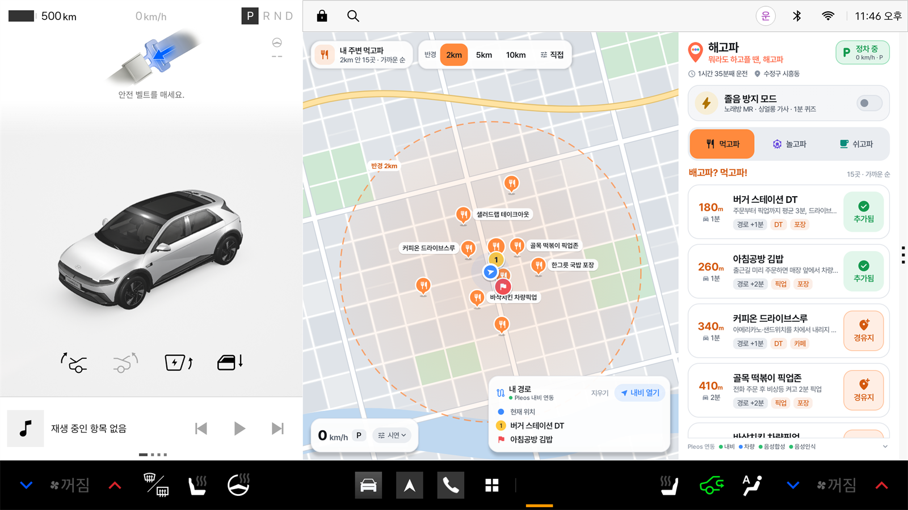
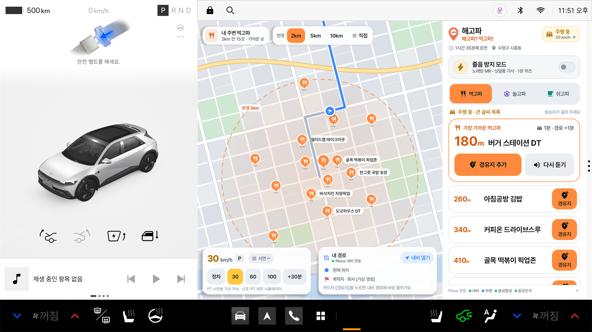
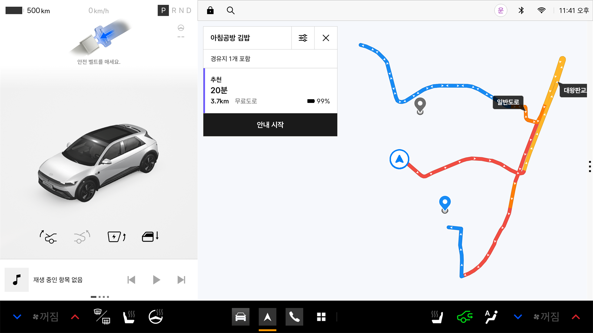
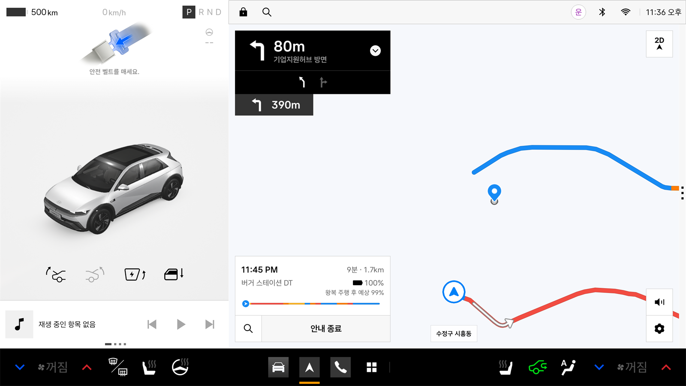
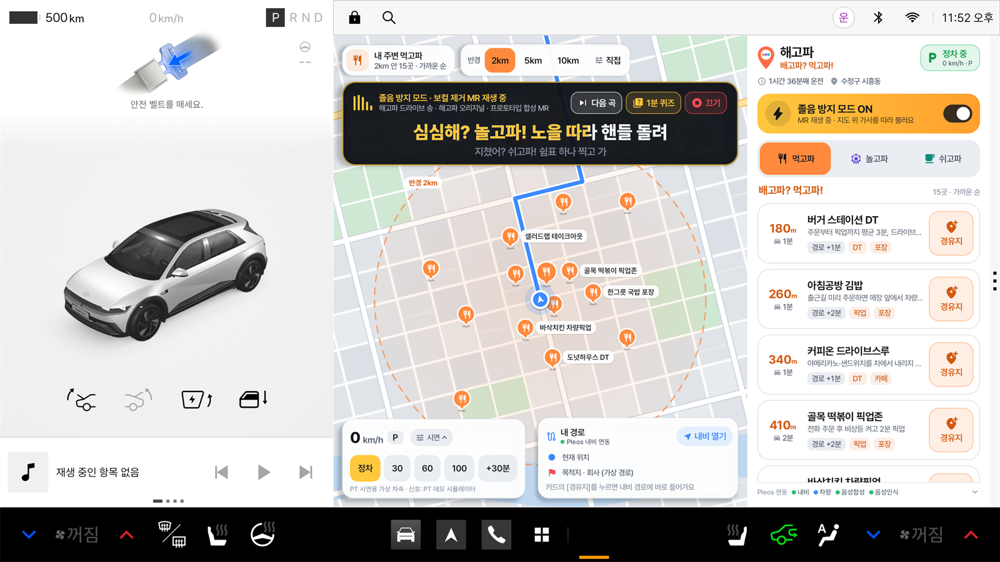
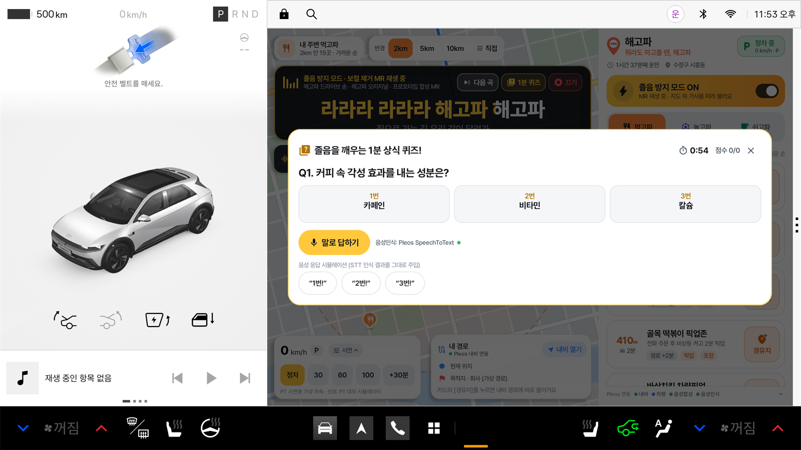
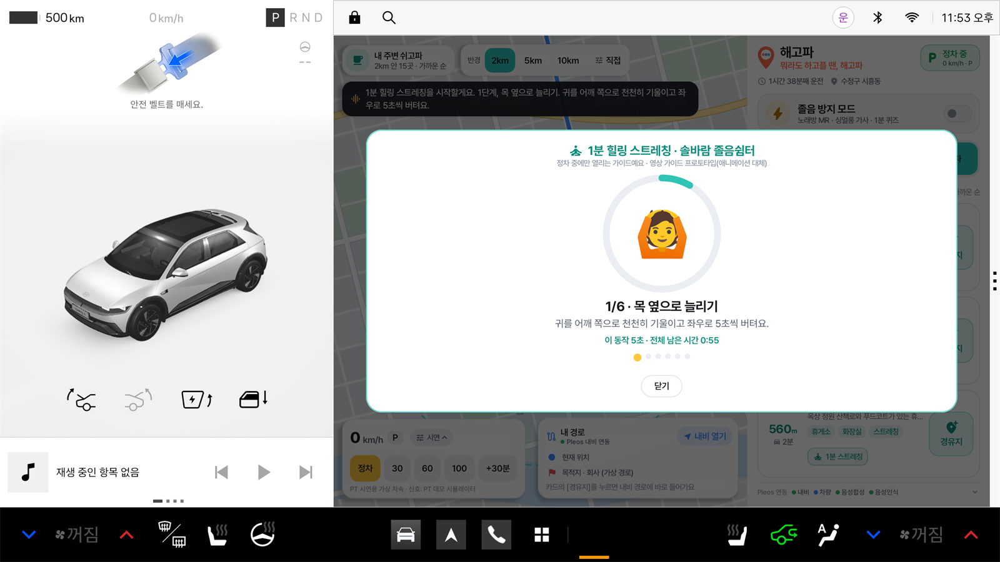
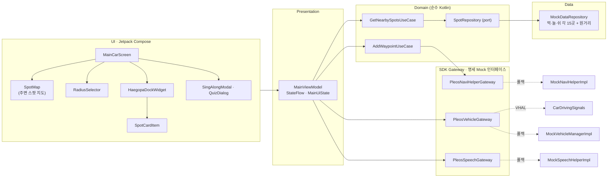

<div align="center">

# 🍽️🎡☕ 해고파 (HAEGOPA)

**배고파? 먹고파! 심심해? 놀고파! 지쳤어? 쉬고파!<br/>차 안에서 뭐라도 하고플 땐? 👉 해고파**

차량 기준 반경(2·5·10km) 먹·놀·쉬 큐레이션 × 순정 내비 원터치 경유지 × 졸음 방지 싱얼롱<br/>
Pleos Connect를 위한 **차량 네이티브** 인포테인먼트 앱 · **Pleos Connect Emulator 실기 검증 완료**

`Android Automotive OS` · `Pleos Connect SDK` · `Kotlin` · `Jetpack Compose` · `MVVM Clean Architecture`

</div>

---

## 📦 바로 실행하기 (심사용 요약)

| 항목 | 내용 |
|---|---|
| **앱 이름** | 해고파 (HAEGOPA) · 패키지 `com.haegopa.app` |
| **한 줄 소개** | 순정 내비와 결합해 차량 기준 반경(기본 2km) 안의 먹·놀·쉬 스팟을 가까운 순으로 추천하고, 원터치 경유지 주입과 노래방 MR 싱얼롱으로 졸음까지 깨우는 차량 전용 앱 |
| **APK 위치** | [`apk/TEAM_HAEGOPA_release.apk`](apk/) — release 빌드 (약 44MB) |
| **권장 테스트 환경** | Pleos Connect Emulator v2.1.0 (Automotive · API 34 · 2560×1440) — ✅ 실기 검증 완료 ([검증 현황](#검증-현황)) |
| **보조 테스트 환경** | 일반 Android AVD (API 28 이상, 폰·태블릿). Pleos SDK가 없으면 내장 Mock으로 자동 전환되어 모든 화면을 시연할 수 있음 |
| **필요한 설정** | ① 첫 실행 시 마이크 권한 허용 (Pleos 내비·음성·차량 권한은 normal 권한이라 설치 시 자동 허용) ② (선택) Virtual Console 연결 `adb forward tcp:8088 tcp:8088` |

```bash
adb install -r -g apk/TEAM_HAEGOPA_release.apk   # -g: 런타임 권한까지 미리 허용
adb shell am start -n com.haegopa.app/.MainActivity
```

> 💡 차속 신호가 없는 환경에서도 지도 좌하단 **[시연]** 패널(정차 / 30 / 60 / 100 km/h · +30분)로 정차·주행 UI 전환을 바로 확인할 수 있습니다.

## 📸 화면

> **Pleos Connect Emulator v2.1.0**(2560×1440)에서 캡처했습니다. 왼쪽은 Pleos 차량 패널이고, 오른쪽 메인 영역이 해고파입니다. Pleos에서는 앱이 순정 내비와 **같은 자리**에 열립니다. 그래서 해고파 화면에는 자체 "주변 스팟 지도"를 두고, 실제 길안내는 순정 내비에 맡깁니다.

| 🅿️ 정차: 반경 거리순 피드 + 순정 내비 경로 연동 | 🚗 주행: 동승자용 큰 글씨 목록 · 경로 따라 이동 · 음성 안내 |
|:---:|:---:|
|  |  |
| **🧭 해고파 [경유지] → Pleos 순정 내비 "경유지 1개 포함" 재탐색** | **🧭 해고파가 보낸 목적지로 순정 내비 길안내 시작** |
|  |  |
| **⚡ 졸음 방지 모드: MR + 노래방식 가사 롤링** | **🧠 1분 상식 퀴즈: Pleos TTS 출제 · Pleos STT 음성 응답** |
|  |  |
| **☕ 쉬고파: 1분 힐링 스트레칭 (정차 전용 · 단계별 음성)** | |
|  | |

---

## 🏁 출품 공모전 개요

> 2026-11-06 기준으로 공식 사이트, 보도자료, Pleos 개발 문서를 확인해 정리했습니다. 세부 사항은 공식 공지가 우선합니다.

| 항목 | 내용 |
|---|---|
| 공모전 | **현대자동차그룹 차량용 앱 개발 공모전 — Code your App into Pleos App Market** |
| 주최 | 현대자동차그룹 |
| 목적 | 차량 데이터·기능·이동 상황을 활용해 운전자와 탑승자에게 새로운 경험을 주는 앱 발굴 |
| 예시 분야 | 모빌리티 & 라이프 편의 · 인카 엔터테인먼트 · 스마트 드라이빙 & 안전 · 패밀리 & 동승자 케어 (주제 제한 없음) |
| 참가 대상 | 대학(원)생 · 일반인 · 스타트업 / 개인 또는 팀(최대 5인) / 대학생 부문 · 일반 부문 |
| 접수 | 2026.10.21(수) ~ **11.15(일)** · 이메일 `appdevchallenge@hyundai-partners.com` · 접수양식(기획서) 필수 |
| 시상 | 총상금 5,100만원 · 10팀 (대상 1,000만원 · 최우수 600만원 · 우수 400만원 · 아이디어 특별상 150만원) + 숏폼 챌린지 50만원 별도 |
| 수상 혜택 | 2027년 2월 현대자동차그룹 행사 전시·시연, Pleos App Market 탑재 준비 지원 (입점이 보장되지는 않음) |
| 개발 환경 요건 | Android API 28 이상 · Gradle 8.0 이상 · Java 또는 Kotlin |
| 제공 SDK | Vehicle · NaviHelper · TextToSpeech · SpeechToText · FusedLocation (Pleos Connect SDK) |

### 일정

| 날짜 | 단계 |
|---|---|
| 2026.10.28 | 온라인 설명회 |
| 2026.11.15 | 접수 마감 |
| 2026.11.23 | 1차 서류심사 결과 발표 |
| 2026.12.03 ~ 12.04 | 2차 최종 PT 심사 (오프라인, **실제 동작하는 앱** 시연 필요) |
| 2026.12.18 | 최종 선정 결과 발표 |
| 2027.02 | 현대자동차그룹 행사 전시 · 시상식 (최종 순위 발표, 전시용 APK 필수) |

### 심사 기준과 해고파의 대응 (1차 서류심사, 배점 비공개)

| 평가 항목 | 공식 설명 (요약) | 해고파의 답 |
|---|---|---|
| **차량특화성** | 모바일보다 나은 차량만의 가치, 주행·정차 맥락과 차량 기능의 결합 | 차속·기어로 UI를 자동 전환(정차: 전체 탐색 / 주행: 동승자용 큰 글씨 목록 + 음성, AAOS UX 제한 기준 준수), 순정 내비 경유지 주입, Pleos 주야간 테마·화면 배율 대응, 차량 오디오로 MR 재생 |
| **창의성** | 독창적 아이디어, 운전자·동승자의 분명한 Pain Point와 해결 방식 | "지금 차 주변 반경 안"이라는 거리 제한 큐레이션(2·5·10km·직접 설정), 노래방 MR 싱얼롱으로 졸음을 깨우는 원터치 부스터 |
| **기술 활용성** | Pleos Playground SDK·API를 핵심 기능에 적절히 활용 | NaviHelper(경유지·길안내·현재 위치·주소·경로 상태 동기화·내비 화면 전환), Vehicle(주행 시간), TTS·STT(도슨트·퀴즈), AAOS VHAL(차속·기어)을 **Pleos Connect Emulator에서 실제로 연동 확인**. 연결 상태를 앱 화면에 표시 |
| **사업성** | 타깃 고객, 사용자 확보와 지속 이용·확대 가능성 | 출퇴근 정체 직장인과 주말 드라이버 타깃, 픽업 주문 제휴·스폰서드 스팟·라이선스 MR 구독 모델 ([사업성 요약](#-사업성-요약)) |

### 제출 규격 준수 현황

| 공식 요구사항 | 상태 |
|---|---|
| README: 앱 이름 및 한 줄 소개 | ✅ [바로 실행하기](#-바로-실행하기-심사용-요약) |
| README: 실행 방법 | ✅ [빌드 & 실행 가이드](#%EF%B8%8F-빌드--실행-가이드) |
| README: 테스트 환경 및 필요한 설정 | ✅ [테스트 환경](#테스트-환경) |
| README: APK 위치 또는 GitHub Release 링크 | ✅ `apk/` 폴더 |
| APK 파일명 `팀명_앱이름_release.apk`, 실행 가능한 release 버전 | ✅ `./gradlew exportCompetitionApk` → `apk/{팀명}_HAEGOPA_release.apk` |
| 개발 환경: API 28+ · Gradle 8.0+ · Kotlin | ✅ minSdk 28 · Gradle 8.11.1 · Kotlin 2.1.10 |
| 가산점: GitHub 저장소(소스 + APK) | ✅ 이 저장소 |
| 가산점: 시연 영상(목업·프로토타입·화면 녹화 인정) | ⏳ 아래 [PT 시연 시나리오](#-pt-시연-시나리오-약-3분) 순서대로 화면 녹화 예정 |

<details>
<summary><b>📮 제출 체크리스트 (팀 참고용)</b></summary>

- 접수양식(기획서)은 공식 사이트에서 받는 **DOCX** 파일(`공모전 접수양식 · 개인정보 수집·이용 동의서`)입니다. 팀원 전원이 동의서에 서명해야 합니다.
- 메일 제목: `[차량용 앱 개발 공모전] 팀명(개인은 성명)_대표자명`. 대표자가 팀원 전원을 **참조(CC)** 해서 보냅니다.
- 수정 제출 제목: `[수정제출] [차량용 앱 개발 공모전] 팀명_대표자명`. 전체 자료와 서명 동의서를 다시 첨부하고, 마감 전 마지막 제출본이 최종본이 됩니다.
- APK는 별도 첨부하지 않고 GitHub 저장소(`apk/` 폴더 또는 Releases)에 소스와 함께 올립니다.
- 비공개 저장소라면 공지된 심사용 GitHub 계정을 Collaborator로 초대합니다(쓰기 권한 주의).
- 접수양식 5번(개발 계획)에 구현 방식, 개발 범위, SDK/API 사용 계획을 구체적으로 적습니다. [Pleos SDK 스펙 매핑](#-pleos-sdk-스펙-매핑) 표를 그대로 활용하면 됩니다.
- (선택) 숏폼 챌린지: 30초~1분 세로 영상을 릴스·쇼츠에 올리고 `#HMG차량용앱개발공모전`을 포함한 해시태그 2~3개를 답니다. 링크는 접수양식에 적습니다.

</details>

**출처** · [공모전 공식 사이트](https://appdevchallenge.auto-hmg.io/) · [지원·제출 방법](https://appdevchallenge.auto-hmg.io/guide/submission) · [심사·시상](https://appdevchallenge.auto-hmg.io/guide/judging-awards) · [개발 환경](https://appdevchallenge.auto-hmg.io/guide/development) · [FAQ](https://appdevchallenge.auto-hmg.io/faq) · [현대차·기아 보도자료](https://www.hyundaimotorgroup.com/ko/news/hyundai-motor-company-kia-vehicle-app-development-contest) · [Pleos 에뮬레이터 설정 가이드](https://document.pleos.ai/docs/connect/guide/getting-started/application-development/setup-connect-sdk-emulator) · [Virtual Console 가이드](https://document.pleos.ai/docs/connect/guide/getting-started/application-development/use-vehicle-emulator) · [Pleos Connect SDK API 레퍼런스](https://document.pleos.ai/api-reference/connect-sdk-pleos)

---

## 💡 기획 배경 & 문제 정의

**운전자의 하루에는 "차 안에서 보내는 애매한 시간"이 많습니다.**

- 🚗 **출퇴근 정체**: 배는 고픈데 어디 들를지 찾으려면 폰을 봐야 하고, 찾더라도 내비에 다시 입력해야 합니다.
- 🌄 **주말 드라이브**: 가까운 곳에 볼거리나 쉴 곳이 있어도 모르고 지나칩니다. 동승자는 심심합니다.
- 😴 **졸음**: 졸음이 와도 할 수 있는 건 창문 열기와 커피 정도입니다. 쉼터가 어디 있는지도 바로 떠오르지 않습니다.

기존 지도·맛집 앱은 **"어디든, 무엇이든"** 찾아 줍니다. 하지만 운전자에게 필요한 건 **"지금 여기서 2km 안, 경로에서 크게 벗어나지 않는 곳"** 입니다. 그리고 그걸 **주행 중에도 안전하게** 쓸 수 있어야 합니다.

### 왜 스마트폰 앱이 아니라 차량 네이티브 앱인가?

| | 스마트폰 앱 | 해고파 (Pleos Connect 네이티브) |
|---|---|---|
| 주행 중 사용 | 운전 중 휴대전화 조작은 도로교통법상 금지이고 위험함 | **차속과 기어를 직접 읽어** 주행 중에는 동승자용 큰 글씨 목록과 음성 안내 중심으로 자동 전환 |
| 내비 연동 | 앱을 전환하고 목적지를 다시 입력해야 함 | **NaviHelper로 순정 내비에 원터치 경유지 주입** |
| 상황 인식 | 휴대폰 GPS 추정에 의존 | 차량 데이터(차속 · 기어 · 연속 주행 시간)로 맥락을 판단 |
| 오디오 | 블루투스 연결 상태에 좌우됨 | 차량 오디오 포커스로 MR과 안내 음성을 직접 제어 |
| 졸음 대응 | 별도 앱을 찾아 실행해야 함 | **원터치 졸음 방지 모드** + 2시간 연속 주행 시 휴식 제안 |

> 해고파는 지도 엔진을 새로 만들지 않습니다. 길 안내는 검증된 **현대차 순정 내비**에 맡기고, 해고파는 "어디에 들를지"만 큐레이션해 **경유지로 주입**합니다. 해고파 화면 왼쪽의 지도는 순정 내비 흉내가 아니라, 반경 안의 추천 스팟과 내 경로를 보여 주는 **해고파 자체의 "주변 스팟 지도"** 입니다.

---

## ✨ 핵심 기능

### 1. 🍽️🎡☕ 먹·놀·쉬 차량 기준 반경 거리순 무한 탐색 + 원터치 경유지

| 탭 | 큐레이션 기준 | 특화 기능 |
|---|---|---|
| 🍽️ **먹고파** | 경로 우회 **5분 이내** 픽업·포장 맛집, 드라이브스루(DT) | 우회 시간(+N분) 표시, 5분 초과 매장 자동 제외 |
| 🎡 **놀고파** | 랜드마크, 드라이브 명소, 숨은 뷰포인트 | **🔊 TTS 도슨트** 해설 |
| ☕ **쉬고파** | 가까운 졸음쉼터, 휴게소, 뷰 카페 | **🧘 1분 힐링 스트레칭 가이드** (10초 × 6동작, 단계별 음성) |

- 순정 내비가 알려 준 현재 위치(NaviHelper `getCurrentLocationInfo` → 주소 예: *수정구 시흥동*, 없으면 가상 위치)를 중심으로 **반경 안의 스팟만**, **가까운 순(오름차순)** 으로 페이지 단위 무한 스크롤을 제공합니다. 반경이 끝나면 "모두 봤어요"로 마무리합니다.
- **검색 반경**: 지도 맨 윗줄에서 `2km` · `5km` · `10km` · `직접 설정(1~20km, 0.5km 단위 슬라이더)` 중 고릅니다. 지도 원 · 목록 · 음성 안내가 함께 바뀝니다. 직접 설정은 슬라이더 조작이 필요하므로 정차 중에만 열립니다.
- 지도에는 목록 스크롤과 상관없이 반경 안의 스팟이 **모두 핀으로** 표시됩니다.
- 카드에는 `거리(320m)` · `스팟 이름` · `소요 시간` · `특징 태그(DT·포장·뷰맛집…)`가 표시됩니다.
- 카드 우측 **[경유지]** 를 누르면 `NaviHelper`를 통해 순정 내비에 등록됩니다. Pleos에서는 순정 내비가 바로 앞으로 나와 재탐색 결과를 보여 줍니다.
  - 경로 안내 중이면 `addWaypoint(... WaypointIndex.FIRST/SECOND)`로 등록합니다. 순정 내비 규격대로 **최대 2곳**입니다.
  - 진행 중인 경로가 없으면 `requestRoute(...)`로 그 스팟까지 바로 길 안내를 시작합니다.
- **내 경로 동기화**: 순정 내비의 실제 목적지 · 경유지(`getDestinationInfo` · `getWaypointInfo` · 경로 이벤트)를 읽어 해고파의 "내 경로" 카드와 지도에 그대로 보여 줍니다. **[내비 열기]** 로 순정 내비 화면으로 바로 넘어갑니다.

### 2. ⚡ 졸음 방지 모드 — 노래방 MR 싱얼롱 + 1분 상식 퀴즈 (원터치 부스터)

- 도크 상단 **[⚡ 졸음 방지 모드 : ON/OFF]** 한 번으로 켭니다.
- 켜면 오디오가 **보컬을 뺀 반주(MR) 모드**로 바뀌고, 지도 상단에 **싱얼롱 가사가 크게 롤링**됩니다. 노래방 자막처럼 진행에 맞춰 글자색이 차오릅니다.
- **🧠 졸음을 깨우는 1분 상식 퀴즈!**
  - TTS가 문제와 보기를 읽어 줍니다.
  - 운전자는 **"2번!"처럼 말로 답하고(STT)**, 앱이 인식 결과를 파싱해 채점합니다. "두 번째", "토성" 같은 표현도 알아듣습니다.
  - 음성 엔진이 없는 환경에서는 **음성 응답 시뮬레이션 버튼**이 같은 인식 결과 문자열을 주입합니다.
- 연속 주행 **2시간**이 지나면 "쉬고파" 탭으로 가까운 쉼터를 제안합니다.

> ⚖️ **정식 라이선스 MR**은 상용화 시 노래방 반주 저작권 보유사와의 B2B 라이선스를 전제로 한 사업 모델입니다. 이 프로토타입은 저작권 문제가 없도록 **반주를 앱에서 실시간 합성**(`MrSynth`)하고, 가사는 모두 **해고파 오리지널 3곡**으로 구성했습니다.

### 3. 🛡️ 안전 주행 적응형 UI (Driver Distraction 대응)

| | 🅿️ 정차 (`Speed == 0 km/h`) | 🚗 주행 (`Speed > 0 km/h`) |
|---|---|---|
| 리스트 | 반경 거리순 무한 스크롤 (상세 카드) | **동승자용 큰 글씨 간편 목록** — 스크롤 가능, **최대 21개**, 거리 · 이름 · [경유지]만 표시. 맨 위에 "가장 가까운 곳" 하이라이트 |
| 상세 · 도슨트 · 스트레칭 · 반경 직접 설정 | 터치로 열기 가능 | 열 수 없음. 주행이 시작되면 열려 있던 창을 **자동으로 닫음**. 목록 항목을 누르면 상세 대신 **음성으로 읽어 줌** |
| 안내 방식 | 화면 중심 + TTS | **TTS 음성 중심** (주행 시작 · 탭 변경 · 반경 변경 · 경유지 추가 시 음성 안내 + 자막) |
| 버튼 | 일반 크기 | 큰 버튼 (경유지 추가 · 다시 듣기) |
| 지도 | 현재 위치 기준 반경 원 | 차량 마커가 **경로를 따라 이동**하고 지나온 길은 회색 (시연용 빨리감기) |

- 차속은 AAOS 표준 VHAL `PERF_VEHICLE_SPEED`, 기어는 `GEAR_SELECTION`으로 받습니다.
- Activity는 `distractionOptimized`로 선언했습니다. 시스템이 앱을 차단하지 않는 대신, **주행 중 UI 제한 책임은 앱이 직접** 집니다.
- **왜 주행 중에 스크롤을 막지 않나요?** 센터 디스플레이는 동승자도 함께 봅니다. AAOS의 주행 중 UX 제한(`CarUxRestrictions.UX_RESTRICTIONS_LIMIT_CONTENT`)도 스크롤 자체를 금지하지 않고 **누적 표시 항목 수(기본 21개)와 문자열 길이**를 제한합니다. 해고파는 이 기준에 맞춰 목록을 21개로 자르고, 글자를 키우고, 설명문·태그·영상은 빼고, 운전자를 위해 가장 가까운 곳은 음성으로 안내합니다.

### 4. 🖥️ Pleos 화면에 맞춘 차량용 UI

- **주야간 테마**: Pleos Connect 기본 화면은 낮에 밝은 테마입니다. 해고파도 시스템 주야간 모드를 따라 라이트 / 다크 팔레트를 자동으로 바꿉니다. 노래방 가사 패널만 무대처럼 늘 어둡게 둡니다.
- **화면 배율**: Pleos 에뮬레이터는 160dpi에 앱 창이 1682×1210dp라서, 일반 태블릿 기준으로 만든 UI는 절반 크기로 보입니다. 창 크기에 비례해 UI 전체를 자동으로 키웁니다(Pleos 약 1.4배, 폰·태블릿 1배).
- **서체 · 아이콘**: 한글 UI 서체 Pretendard와 Material Symbols 벡터 아이콘을 앱에 넣어, 기기마다 다른 기본 글꼴이나 이모지 렌더링에 기대지 않습니다.
- **개발용 정보 숨김**: SDK 연동 상태는 도크 맨 아래 한 줄(눌러서 펼치기)로, PT 시연 패널은 접힌 상태로 둡니다.

---

## 🔌 Pleos SDK 스펙 매핑

명세서의 **Mock 인터페이스 3종**(`MockNaviHelper` · `MockVehicleManager` · `MockSpeechHelper`)은 시그니처 그대로 유지했습니다. 구현체는 **실제 Pleos SDK 어댑터**이며, Pleos 서비스가 없는 기기(일반 AVD)에서는 **내장 Mock으로 자동 폴백**합니다. 그래서 같은 APK가 Pleos 에뮬레이터와 일반 AVD 양쪽에서 동작합니다.

| 명세 인터페이스 | 실제 연동 (Maven 버전) | 사용 API | 폴백 |
|---|---|---|---|
| `MockNaviHelper.addWaypoint()` | **NaviHelper 3.0.5** | `NaviHelper(context).initialize(onSuccess, onFail)`<br/>경로 안내 중: `addWaypoint(RequestWaypointInfo(lat, lng, name, WaypointIndex.FIRST/SECOND, …))`<br/>경로 없음: `requestRoute(RouteInfo(…))`<br/>상태 동기화: `getRouteStateInfo()` · `getDestinationInfo()` · `getWaypointInfo()` · `onNavigationStatus` · `onRouteStarted/Ended/Cancelled`<br/>반경 원점: `getCurrentLocationInfo()` (좌표 + 주소) | `MockNaviHelperImpl` (가상 경로에 최대 2곳) |
| `MockVehicleManager.setSpeedChangeListener()` | **AAOS Car API** (`android.car`) | `CarPropertyManager.registerCallback(PERF_VEHICLE_SPEED)` → km/h<br/>`GEAR_SELECTION` → P/R/N/D | [시연] 패널 (정차/30/60/100) |
| `MockVehicleManager.getTripDurationMinutes()` | **Vehicle 2.3.2** | `Vehicle(context).initialize()` → `getOdometer().registerTripCurrentDrivingTime()` | 앱 실행 시각 기준 경과 시간 |
| `MockSpeechHelper.speakText()` | **TextToSpeech 3.3.1** | `TextToSpeech(context, Mode.ON_DEVICE)` · `initialize()` · `setLocale(KOREA)` · `speak()` | Android TTS → 자막 모드 |
| `MockSpeechHelper.startVoiceRecognition()` | **SpeechToText 3.3.1** | `SpeechToText(context, Mode.ON_DEVICE)` · `addListener(ResultListener)` · `request()` | Android `SpeechRecognizer` → 음성 응답 시뮬레이션 |

**설계 메모 (실제 SDK 바이너리를 분석해 반영한 내용)**

- Pleos Vehicle SDK 2.3.2에는 **차속 API가 없습니다.** 기어 API(`registerGearSelection`)도 deprecated이며 SDK가 *"use the Google GEAR_SELECTION property"* 를 권고합니다. 그래서 차속과 기어는 AAOS 표준 VHAL로, Pleos Vehicle SDK는 주행 시간(Odometer)에 사용합니다.
- Pleos Virtual Console(v2.1.0)의 Motion 도메인은 **기어(P/R/N/D)** 를 바꿀 수 있습니다. 에뮬레이터에서만 **기어 D → 가상 30km/h, P → 0km/h** 로 주행 상태를 시연할 수 있게 했습니다. 실차에서는 실제 차속이 들어오면 실제 값이 항상 우선합니다.
- NaviHelper의 경유지 슬롯은 `WaypointIndex.FIRST / SECOND` 두 개입니다. Mock도 같은 한도(2곳)를 적용했습니다.
- Pleos 서비스가 없는 기기에서 SDK를 초기화하면 SDK가 서비스 바인딩을 계속 재시도합니다. 그래서 시작할 때 `PleosServiceProbe`로 Pleos 서비스 패키지가 있는지 확인하고, 없으면 SDK를 만들지 않고 바로 Mock으로 동작합니다.
- 오디오 출력을 열 수 없는 환경에서는 반주 없이 **가사만 시계 기준으로 흐르는 무음 모드**로 자동 전환합니다.
- 도크 맨 아래 **"Pleos 연동"** 줄에서 각 SDK가 실제 Pleos(초록), Android 기본(파랑), Mock(회색) 중 무엇으로 동작하는지 볼 수 있습니다. 누르면 상세 이름과 차속 신호원이 펼쳐집니다.

**Pleos Connect Emulator에서 직접 확인하고 반영한 내용**

| 발견 | 대응 |
|---|---|
| NaviHelper 요청이 `SecurityException: Permission [pleos.car.permission.NAVI_ROUTE_SEARCH] is required` 로 거절됨 | 매니페스트에 Pleos 권한 선언. 에뮬레이터의 `pm list permissions`로 확인한 결과 모두 `protectionLevel=normal`이라 설치 시 자동 허용됨 |
| Pleos TTS가 `initialize()` 성공 전에 `addEventListener()`를 부르면 `lateinit property tts has not been initialized`로 실패 | 이벤트 리스너를 초기화 성공 콜백 안에서 등록 |
| 길안내 중인데도 `RouteStateInfo.isRouting = false`, `naviMode = ROUTE_GUIDING` 으로 응답 | `NaviMode`(ROUTE/SIMULATION_GUIDING) · `NavigationStatus.ROUTE_DRIVE` · 남은 거리가 있는 목적지를 함께 보고 "안내 중"을 판정. 그래야 두 번째 스팟이 목적지를 덮어쓰지 않고 **경유지**로 들어감 |
| `WaypointInfo` 좌표가 `(0.0, 0.0)` · display 좌표 `null` 로 옴 (목적지 좌표는 정상) | 해고파가 보낸 스팟 좌표를 이름으로 저장해 두고 보완 (앱 재시작 후에도 유지) |
| Vehicle `TRIP_DRIVING_TIME` → `ERROR_NOT_SUPPORTED_PROPERTY` (에뮬레이터) | 앱 기준 주행 시간으로 폴백, 시연 패널 `+30분`으로 피로 알림 시연 |
| Pleos 이미지에서 `cmd car_service inject-vhal-event` 권한 거부 | Virtual Console 기어(D/P) 또는 지도 좌하단 [시연] 패널로 주행 전환 |
| 앱 창이 160dpi · 1682×1210dp (차량 패널 오른쪽 메인 슬롯) | 창 크기 비례 UI 배율 적용 |

```xml
<!-- AndroidManifest.xml — Pleos 권한 (모두 normal) -->
<uses-permission android:name="pleos.car.permission.NAVI_ROUTE_SEARCH" />  <!-- 경로 탐색 · 경유지 주입 -->
<uses-permission android:name="pleos.car.permission.NAVI_ROUTE" />         <!-- 경로 · 현재 위치 조회 -->
<uses-permission android:name="pleos.car.permission.NAVI_NOTIFY" />        <!-- 길안내 이벤트 -->
<uses-permission android:name="pleos.car.permission.TTS_SERVICE" />
<uses-permission android:name="pleos.car.permission.STT_SERVICE" />
<uses-permission android:name="pleos.car.permission.CAR_DRIVE" />
<uses-permission android:name="pleos.car.permission.CAR_INFO" />
```

```kotlin
// settings.gradle.kts — Pleos 공식 Maven (인증 불필요)
maven { url = uri("https://nexus-playground.pleos.ai/repository/maven-releases/") }

// app/build.gradle.kts
implementation("ai.pleos.playground:Vehicle:2.3.2")
implementation("ai.pleos.playground:NaviHelper:3.0.5")
implementation("ai.pleos.playground:TextToSpeech:3.3.1")
implementation("ai.pleos.playground:SpeechToText:3.3.1")
```

---

## 🏗️ 아키텍처 (MVVM Clean Architecture)



```
HaeGoPa/
├── apk/                                   # 공모전 제출 APK ({팀명}_HAEGOPA_release.apk)
├── docs/screenshots/                      # README 스크린샷
├── app/src/main/java/com/haegopa/app/
│   ├── MainActivity.kt · HaegopaApplication.kt
│   ├── di/AppContainer.kt                 # 수동 DI (앱 단일 인스턴스)
│   ├── domain/                            # 모델 · 유스케이스 · 저장소 포트 · GeoUtils
│   ├── data/                              # MockDataRepository · SingAlongCatalog · QuizBank
│   ├── sdk/
│   │   ├── PleosSdkContracts.kt           # 명세 4장 Mock 인터페이스 + 확장 계약
│   │   ├── pleos/                         # 실제 Pleos SDK 어댑터 (자동 폴백)
│   │   ├── car/CarDrivingSignals.kt       # AAOS VHAL 차속 · 기어
│   │   └── mock/                          # 일반 AVD용 Mock 구현
│   ├── audio/                             # MrSynth(반주 합성) · MrSynthPlayer(AudioTrack + 오디오 포커스)
│   ├── presentation/                      # MainViewModel · MainUiState
│   └── ui/                                # MainCarScreen · SpotMap · RadiusSelector · HaegopaDockWidget · SpotCardItem · SingAlongModal …
│       └── theme/                         # 주야간 팔레트 · Pretendard 타이포 · 화면 배율(LocalUiScale)
├── app/src/main/res/drawable/ic_*.xml     # Material Symbols 벡터 아이콘
├── app/src/main/res/font/                 # Pretendard (OFL)
├── licenses/                              # 서체 라이선스
└── app/src/test/                          # JVM 단위 테스트 25개
```

| 계층 | 기술 |
|---|---|
| 언어 / 빌드 | Kotlin 2.1.10 · AGP 8.7.3 · Gradle 8.11.1 · compileSdk 35 · minSdk 28 · targetSdk 35 |
| UI | Jetpack Compose (BOM 2024.12.01) · Material 3 · Canvas (주변 스팟 지도 · 이퀄라이저 · 진행 링) · Pretendard · Material Symbols |
| 비동기 / 상태 | Kotlin Coroutines · StateFlow · SharedFlow · lifecycle-viewmodel |
| 차량 | Pleos Connect SDK (NaviHelper · Vehicle · TTS · STT) · AAOS Car API (`useLibrary("android.car")`) |
| 오디오 | AudioTrack(MODE_STREAM) · AudioFocusRequest(USAGE_MEDIA) |

---

## 🛠️ 빌드 & 실행 가이드

### 요구 사항

- Android Studio (Ladybug 2024.2 이상 권장) · 내장 JDK(JBR) 17 이상
- Android SDK Platform 35, Build-Tools 34 이상
- 인터넷 연결 (Gradle · Google Maven · Pleos Maven에서 의존성 다운로드)

> ⚠️ **Windows에서는 영문 경로에 두고 빌드하세요.** 경로에 한글이나 공백이 있으면(예: `C:\...\개인 프로젝트\`) Android Gradle Plugin이 경고를 내고, 단위 테스트 실행 시 `ClassNotFoundException`이 납니다. 이 저장소는 `android.overridePathCheck=true`로 APK 빌드까지는 되게 해 두었지만, `C:\dev\HaeGoPa`처럼 영문 경로를 권장합니다.

### 명령어

```bash
# 디버그 APK → app/build/outputs/apk/debug/app-debug.apk
./gradlew assembleDebug

# 단위 테스트 (25개)
./gradlew testDebugUnitTest

# 공모전 제출용 release APK → apk/{팀명}_HAEGOPA_release.apk
#   팀명은 gradle.properties 의 haegopa.teamName 으로 지정 (영문 권장)
./gradlew exportCompetitionApk
```

- **release 서명**: 저장소 루트에 `keystore.properties`(git 제외 대상)가 있으면 팀 키로 서명합니다. 없으면 바로 설치할 수 있게 debug 키로 서명합니다.

  ```properties
  storeFile=keystore/haegopa-release.jks
  storePassword=****
  keyAlias=haegopa
  keyPassword=****
  ```

### 테스트 환경

#### A. Pleos Connect Emulator (권장 · 공모전 공식 환경)

1. Android Studio → **Tools > SDK Manager > SDK Update Sites** → `+`
   - Name: `Pleos Connect System Image`
   - URL (Windows/Linux): `https://nexus-playground.pleos.ai/repository/raw-releases/connect-avd/2.x/crp-sys-img.xml`
   - URL (Mac): `https://nexus-playground.pleos.ai/repository/raw-releases/connect-avd/2.x/crp-arm64-sys-img.xml`
2. **SDK Platforms** 탭 → *Show Package Details* → API 34의 **Pleos Connect** 시스템 이미지 설치 → Android Studio 재시작
3. Device Manager → 새 AVD: Form factor **Automotive**, 기기 **Pleos Connect v2.1.0**(2560×1440 · 160dpi), 이미지 API 34 *Pleos Connect v2.1.0 APIs*, **Default boot: Cold**, RAM 8GB(이미지 권장값)
4. 앱 설치 후 실행 → 마이크 권한 허용 (Pleos 내비·음성·차량 권한은 설치 시 자동 허용)
   ```bash
   adb install -r -g apk/TEAM_HAEGOPA_release.apk   # -g 로 런타임 권한까지 미리 허용
   adb shell am start -n com.haegopa.app/.MainActivity
   ```
   하단 Pleos 독에 해고파 아이콘이 생기고, 앱은 차량 패널 오른쪽 메인 영역(순정 내비와 같은 자리)에 열립니다.
5. **Virtual Console** (에뮬레이터 v2.1.0 이상)
   ```bash
   adb forward tcp:8088 tcp:8088
   # 브라우저에서 http://127.0.0.1:8088/ → Motion > Gear 를 D 로 바꾸면 주행 모드, P 로 바꾸면 정차 모드
   ```
6. VHAL 차속 직접 주입(`cmd car_service inject-vhal-event`)은 Pleos v2.1.0 이미지에서 권한 오류로 막혀 있습니다. 주행 시연은 5번의 기어 전환이나 앱의 **[시연]** 패널을 쓰세요.
7. 에뮬레이터가 "응답 없음"으로 멈추면 Device Manager에서 **Cold Boot Now** 로 다시 켜세요. 장시간 시연 전에는 `./gradlew --stop`으로 Gradle 데몬을 내려 메모리를 확보하는 것이 좋습니다.

#### B. 일반 Android AVD / 실기기 (API 28 이상)

- 그대로 설치해서 실행하면 됩니다. Pleos SDK와 Car API가 없으니 Mock으로 자동 전환됩니다(하단 배지가 회색 **Mock**).
- 가로 화면은 16:9 분할 레이아웃, 세로 화면은 지도(위) / 도크(아래) 레이아웃으로 표시됩니다.
- 차속은 지도 좌하단 **[시연]** 패널로 바꿉니다. 음성 엔진이 없으면 TTS 문장은 **화면 자막**으로, STT는 **음성 응답 시뮬레이션 버튼**으로 대신합니다.

#### 검증 현황

| 항목 | 결과 |
|---|---|
| 단위 테스트 25개 (반경·거리순·페이징 · 우회 5분 필터 · 퀴즈 음성 파싱 · 가사 싱크 · 경유지 한도 · 주행 판정 · MR 합성) | ✅ 통과 |
| `assembleDebug` · `exportCompetitionApk`(release) | ✅ 성공 |
| **Pleos Connect Emulator v2.1.0** (2026-11-06) — NaviHelper 연결, 현재 위치·주소("수정구 시흥동")를 반경 원점으로 사용 | ✅ 확인 |
| ↳ 해고파 [경유지] → `requestRoute` → 순정 내비가 해당 스팟까지 경로 탐색 · 길안내 시작 | ✅ 확인 (위 스크린샷) |
| ↳ 길안내 중 [경유지] → `addWaypoint(FIRST)` → 순정 내비 "경유지 1개 포함" 재탐색 | ✅ 확인 (위 스크린샷) |
| ↳ 순정 내비의 목적지 · 경유지를 해고파 "내 경로"와 지도에 동기화, [내비 열기]로 화면 전환 | ✅ 확인 |
| ↳ Pleos TextToSpeech(ON_DEVICE · ko-KR) 음성 안내, Pleos SpeechToText 연결 | ✅ 확인 (실제 마이크 음성 인식 정확도는 PT 환경에서 재확인 필요) |
| ↳ 정차/주행 전환 · 동승자 목록 · 차량 이동 · 반경 2/5/10km · MR 싱얼롱 · 퀴즈 · 스트레칭 | ✅ 확인 (크래시 없음) |
| ↳ Vehicle 주행 시간(`TRIP_DRIVING_TIME`) | ⚠️ 에뮬레이터 미지원 → 앱 기준 시간으로 폴백 |
| ↳ Virtual Console 기어 연동 | ✅ 기어 P 수신 확인 · D(주행) 전환은 PT 리허설에서 확인 예정 |
| 일반 AVD (Mock 폴백) | ✅ 이전 UI에서 확인 · 새 UI는 Pleos 에뮬레이터 기준으로 확인 |
| Pleos 서비스가 없는 기기에서 SDK 재연결 루프 방지 (`PleosServiceProbe`) | ✅ 확인 |

---

## 🎬 PT 시연 시나리오 (약 3분)

1. **정차 상태(0 km/h)로 실행**: 순정 내비가 알려 준 현재 위치(예: 수정구 시흥동) 기준으로 🍽️ 먹고파 카드가 거리순으로 뜹니다. 지도 윗줄에서 반경을 `5km` · `10km`로 넓히면 먼 스팟이 지도와 목록에 함께 나타납니다.
2. **원터치 경유지 (핵심)**: `아침공방 김밥` **[경유지]** → Pleos 순정 내비가 앞으로 나와 길안내 시작 → 다시 해고파에서 `버거 스테이션 DT` **[경유지]** → 순정 내비 **"경유지 1개 포함"** 재탐색. 해고파 "내 경로" 카드와 지도에도 ① 경유지 · 🚩 목적지가 그대로 동기화됩니다.
3. **놀고파 · 도슨트**: `노을 전망 언덕` **[도슨트 듣기]** → Pleos TTS 해설 + 화면 자막
4. **쉬고파 · 스트레칭**: `솔바람 졸음쉼터` **[1분 스트레칭]** → 6동작 음성 가이드
5. **주행 시작**: Virtual Console 기어 **D**(또는 [시연] `30`) → 스트레칭 창이 자동으로 닫히고, 동승자용 큰 글씨 목록으로 바뀌며, 지도 위 차량이 경로를 따라 달리고, 가장 가까운 곳을 음성으로 안내합니다.
6. **⚡ 졸음 방지 모드 ON** → MR 반주와 함께 가사가 롤링됩니다 → **1분 퀴즈** → TTS 문제 → *"2번!"* (Pleos STT 또는 시뮬레이션 버튼) → 채점
7. **피로 알림**: [시연] `+30분` → *"2시간째 운전 중"* 알림 → **[쉼터 보기]** → 가까운 졸음쉼터
8. **정차**: 기어 **P**(또는 `정차`) → 전체 카드 목록으로 복귀

---

## 💼 사업성 요약

| 구분 | 내용 |
|---|---|
| 핵심 타깃 | ① 매일 출퇴근 정체를 겪는 직장인 ② 주말 드라이브를 즐기는 운전자와 동승자(가족 · 연인) |
| 사용 맥락 | 퇴근길 픽업, 주말 즉흥 드라이브, 장거리 운전 중 졸음과 휴식 |
| 수익 모델(안) | ① 픽업 · DT 사전 주문 연동 제휴 수수료 ② 반경 2km 로컬 스폰서드 스팟(광고 표기) ③ 라이선스 MR 프리미엄 구독(차량 커넥티드 서비스 번들) |
| 핵심 지표 | 주간 경유지 주입 수, 2km 피드 → 경유지 전환율, 졸음 방지 모드 사용 시간, D7 · D30 리텐션 |
| 확장 | EV 충전 대기 시간 콘텐츠, 동승자 모드, 장거리 여행 코스 큐레이션, 차종 · 지역 확대 |

> 예상 MAU와 리텐션 같은 수치 목표는 접수양식(기획서)에 근거와 함께 적습니다.

---

## 🗺️ 로드맵

- [x] Pleos Connect Emulator 실기 검증 (경유지 주입 · 길안내 · 경로 동기화 · TTS/STT)
- [ ] 시연 영상 녹화 (1차 가산점)
- [ ] 백그라운드 음성 코파일럿: 순정 내비 화면을 띄운 채 해고파가 뒤에서 추천을 말하고(TTS), *"응, 추가해 줘"*(STT)로 승인하면 경유지 주입
- [ ] Pleos LLM SDK로 도슨트 해설 · 퀴즈 문제 생성
- [ ] 실제 POI 데이터 연동 (영업시간 · 혼잡도 · 픽업 가능 여부)
- [ ] FusedLocation SDK로 주행 중 2km 원점 실시간 갱신
- [ ] 경유지 도착 시 도슨트 자동 재생 (`NaviHelperEventListener.onWayPointArrived`)
- [ ] 음성 명령: *"근처 졸음쉼터 가자"* → 바로 경유지 주입
- [ ] 정식 라이선스 MR 스트리밍 (B2B 계약)

---

## ⚖️ 저작권 · 데이터 고지

- **반주(MR)**: 앱이 실시간으로 합성하는 더미 음원입니다. 상용 음원이나 녹음물을 쓰지 않았습니다.
- **가사**: 「해고파 드라이브 송」 「졸음아 물러가라」 「퇴근길 떼창」 3곡 모두 해고파 팀 오리지널입니다.
- **스팟 데이터**: 상호명과 좌표는 모두 **가상**입니다(실존 업체와 무관). 현재 위치 기준 거리·방위로 생성됩니다.
- **지도**: 해고파 "주변 스팟 지도"는 Canvas로 그린 일러스트 지도(가상의 도시)이며 실제 지도 데이터를 쓰지 않습니다. 실제 길안내는 Pleos 순정 내비가 합니다.
- **서체**: [Pretendard](https://github.com/orioncactus/pretendard) — SIL Open Font License 1.1 ([`licenses/Pretendard-OFL.txt`](licenses/Pretendard-OFL.txt))
- **아이콘**: [Material Symbols](https://github.com/google/material-design-icons) (Google) — Apache License 2.0
- **Pleos SDK · 에뮬레이터**: 현대자동차그룹 Pleos Playground가 공모전 참가자에게 제공하는 SDK와 Pleos Connect Emulator를 42dot SDK 라이선스에 따라 사용했습니다. 에뮬레이터 이미지는 저장소에 포함하지 않습니다.

---

<div align="center">

**해고파 (HAEGOPA)** — 현대자동차그룹 차량용 앱 개발 공모전 *Code your App into Pleos App Market* 출품작

</div>
